# Suhail: Ages of Arabia: Game Design Document v4.0

Oct 27, 2026 · @Filip Ivanovic

## How to read this document

This is version 4.0 of the design. It replaces v3.1 and answers the full
review of the earlier versions.

Every major mechanic is explained in the same four steps, so you always
know where to look:

- **What it is.** The idea in plain words.

- **How it works.** What the player does and what the rules are.

- **Why it matters.** What the mechanic does for the game as a whole.

- **Why it is fun.** The choice, challenge or reward it gives the
  player.

Each mechanic also carries a status label. We use these so you can tell
settled design from new suggestions.

| Label         | Meaning                                                                                              |
|---------------|------------------------------------------------------------------------------------------------------|
| **Confirmed** | Carried over from v3.1. Not in question.                                                             |
| **Proposed**  | New or changed in v4. We recommend it, and it needs your sign-off.                                   |
| **Open**      | Needs a decision from you. Each one is listed in the Open decisions section with our recommendation. |

All numbers are starting values. They will be tuned against real player
data after soft launch. The Revision notes section at the end lists
every change since v3.1.

## 1. What this game is

Suhail: Ages of Arabia is a mobile game about growing one town through
seven periods of Arab history. It starts at a desert well around 500 BCE
and ends with the founding of the United Arab Emirates in 1971.

You build your town on a small grid. It produces food, money and
knowledge, and it keeps producing while your phone is in your pocket.
You send caravans and ships to trade, and you decide how much risk to
take on each trip.

You are not alone. Six rival towns share your region. You can trade with
them, raid them, defend against them or win them over. Real historical
figures join your court and help you, each with an ability based on
something they actually did.

Every few days your town reaches the end of its age. It moves into the
next century. Everything you built is restyled for the new era, new
kinds of building open up and new problems arrive. Your leaders and
everything you have learned come with you. Seven times, you watch your
town become something new.

Along the way, short questions about the history you are living through
pop up. Knowing the answer makes you stronger. Getting it wrong costs
nothing and teaches you something.

**In one sentence:** build a civilization across seven ages of Arab
history, command the people who actually shaped it, and learn something
true while you do it.

### Why it can make money

The Gulf states are among the highest-spending mobile gaming markets in
the world, measured per player. Very little good game content is made
for them, in Arabic, about their own history.

Our game is cheap to build compared with a big strategy game. The
simulation runs on the player's phone, and there is no real-time
multiplayer to build or defend.

### Why it is hard to copy

A competitor could copy our game loop in about four months. They could
not copy four hundred sourced history entries, a question bank approved
by a historian, or the relationships with cultural institutions that
this research opens. Our protection is the depth of the content, not the
code.

## 2. Your first week

Before any rules or numbers, this is what playing the game feels like.
It follows one player through their first seven days.

### Day 1, morning

The game opens on a caravan reaching a dry well in the desert. An old
storyteller, the Rawi, tells you this is where your people will stay.
You tap the well. Water comes up.

You plant date palms. When you place one next to the water channel, the
game shows it growing faster than the others. Nobody explains adjacency
to you. You just see it, and you start placing everything next to water.

The Rawi gives you your first leader, Zenobia, the queen of the caravan
city of Palmyra. He also gives you her camel staff. You will still be
using it a week from now.

You send your first caravan to the coast. Halfway there, you must
choose: rest at an oasis, or push on through the heat. Both work this
time. The caravan comes back with silver and a fragment that will later
make Zenobia stronger.

A few riders test your watchtower. The game shows you who they are
before the fight. You put spearmen with shields in front, because
shields stop horses. You win in fifteen seconds.

A question appears: why did merchants cross the desert in large caravans
rather than alone? You answer. Your first entry in the Archive opens, a
short page about caravan life with a picture. You close the app.

### Day 1, lunch and evening

At lunch your storehouses have filled while you were away. You collect,
upgrade a palm grove and send another caravan. It takes ninety seconds.

In the evening a second town appears on your map, an oasis to the north.
Their envoy offers a trade deal. You accept, and now you have a
neighbour with a name, a mood and a reason to keep an eye on you.

### Days 2 and 3

You finish the Great Falaj, the largest water channel in the region. The
age turns. Your town moves into a new century. Your buildings keep their
levels and take on a new style, and a mosque, a judge's court and a
market open up. Your money is now the silver dirham.

The town grows quickly. Too quickly. Two farmers argue over who gets the
water at night. You can let the judge decide, split the hours between
them, or pay one of them off. Each choice has a cost, and you start to
see that a growing town needs governing.

### Days 4 and 5

You choose your doctrine: the kind of civilization you want to be. You
pick the Merchants. Two of your leaders suddenly feel stronger, because
their talents suit that path. A neighbour raids your caravan. You decide
whether to strike back or send an envoy.

### Days 6 and 7

You now have four leaders ready to promote and not enough money to
promote all of them. Your treasury is nearly full, too, so you cannot
just save. You have to choose.

You put some of your money into a partnership with a merchant's caravan.
If the trip goes well, you share the profit. If it goes badly, you lose
your stake. You wait, and it pays.

At the end of the week you have seen your town change twice. You know
three rivals by name. You have read twenty pages of real history without
being told to. And for the first time, you can see the sea.

### What brings you back

There is always something waiting: a caravan coming home, a storehouse
filling, a neighbour making a move, a leader one step from promotion.
Each visit can take one minute or ten, and both feel worthwhile.

## 3. The five pillars

The game is made of five parts. Every feature in this document belongs
to one of them. If a new idea does not fit any of the five, it does not
belong in version one.

| Pillar                | In one sentence                                                              | What it contains                                                    | Status                         |
|-----------------------|------------------------------------------------------------------------------|---------------------------------------------------------------------|--------------------------------|
| **1. The Settlement** | You build a town that keeps producing while you are away.                    | The grid, buildings, production, storage, the water limit, disputes | Confirmed, expanded            |
| **2. The Court**      | You collect real historical figures and give them real historical tools.     | Leaders, court officers, instruments, doctrines                     | Confirmed, expanded            |
| **3. The Region**     | You share a map with six rival towns and send caravans and ships across it.  | Routes, risk choices, rivals, raids, defence, diplomacy             | Proposed: rivals are new in v4 |
| **4. The Chronicle**  | Knowing real history makes you better at the game.                           | History questions, the Archive                                      | Confirmed                      |
| **5. The Age**        | Every few days you leap forward a century, and your town transforms with it. | Research, the age change, legacy, the four endings                  | Confirmed, expanded            |

The order matters. It is the order in which the player meets the
pillars, and the order in which we demonstrate the game.

The biggest change in v4 is pillar 3. In v3.1 it was called the Route
and covered trips alone. It now includes the six rival towns, which
gives conflict, trade and diplomacy a real place in the game. Section 11
explains it in full.

## 4. How the game unfolds

**Status: Proposed.** The stages are shorter than in v3.1, and there are
nine of them instead of seven.

The game teaches one new idea at a time. A new system only appears once
the player has used the last one a few times and felt its result.
Nothing unlocks because a clock ran out; everything unlocks because the
player did something.

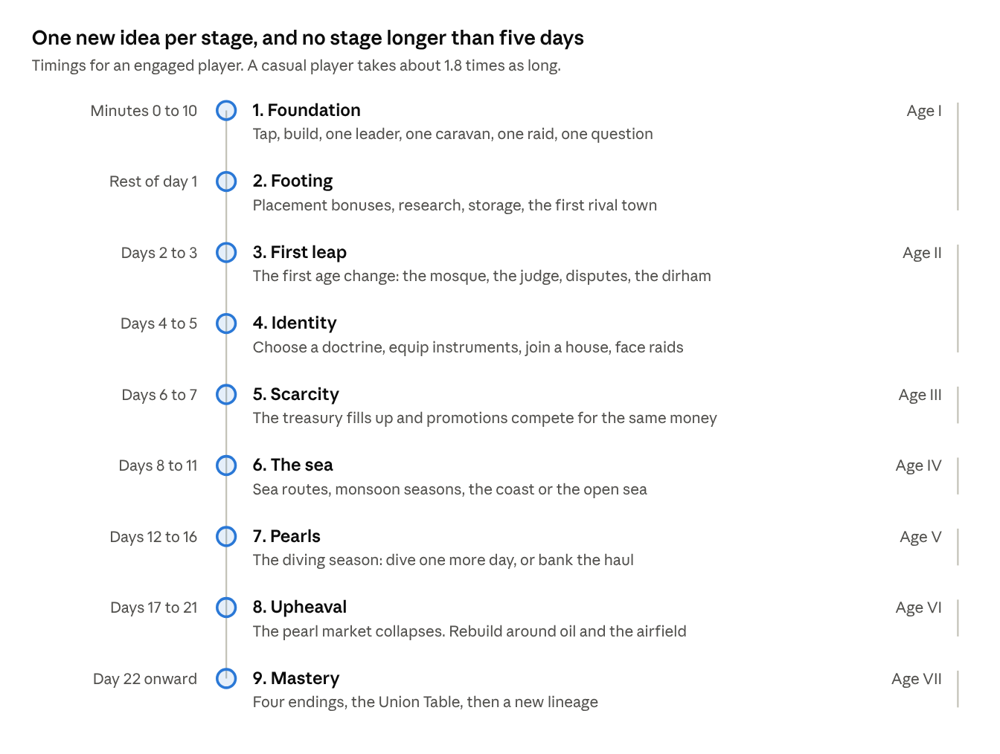

the progression ladder · 9 stages across 7 ages

Read it from the top. Each stage adds one idea to everything that came
before. The labels on the right show which historical age the player is
in.

### Why the timings changed

You were right that v3.1 jumped too far. Stage 1 lasted ten minutes,
then Stage 2 lasted up to five days. Later stages ran for two weeks
without anything new. On a phone, that is long enough to lose a player.

We now follow three rules:

1.  **On day 1, every visit shows something new.** The first rival town,
    research and a second caravan all arrive before the player's first
    night.

2.  **The first age change happens on day 2.** In v3.1 it came on day 3.
    The age change is the heart of the game, so players should feel it
    early.

3.  **After the first week, no stage lasts longer than five days.** The
    old fifteen-day stretch is now three stages: the sea, pearls and the
    upheaval.

To make this work we shortened Age I from about three days to about a
day and a half for an engaged player. Total time from the first tap to
Age VII drops from about 47 days to about 21. Section 18 explains how
this changes for casual players.

## 5. The core loop

**Status: Confirmed, with one change.** Routes now go to rival towns as
well as markets.

The core loop is what the player does on every visit. It has six steps.
A quick visit covers the first three; a longer one goes all the way
round.

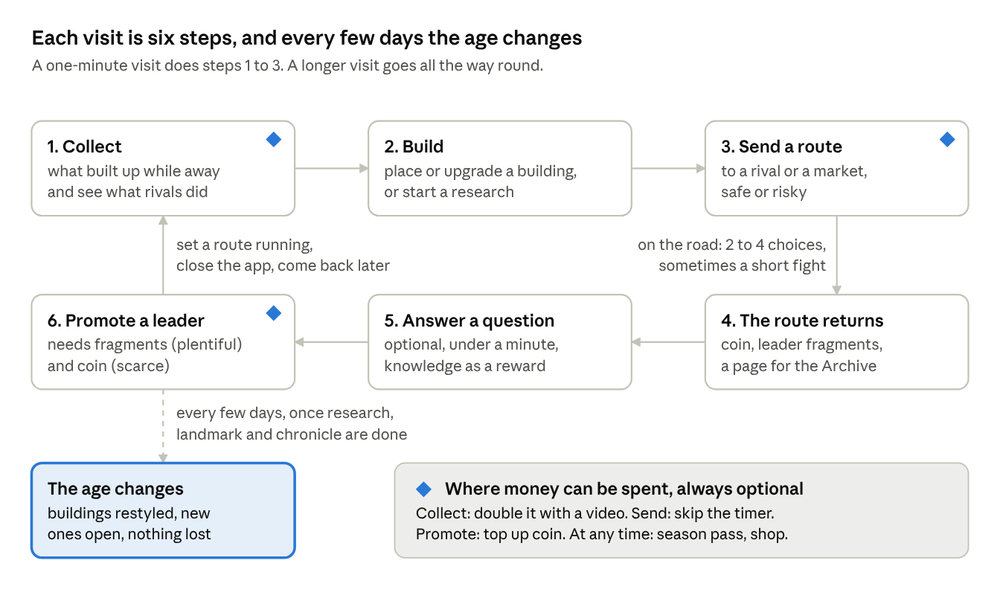

the core loop · 6 steps per visit, plus the age change

Start top left and follow the arrows. Steps 1 to 3 take under a minute.
Step 6 is where the player most often feels the limits of the economy,
which is why it is also the main place where money can be spent. The age
change sits outside the loop because it happens every few days, not
every visit.

### Why it is built this way

People play phone games in short gaps: a queue, a coffee break, ten
minutes before bed. The loop has to feel complete in one minute and
still reward ten. Steps 1 to 3 give the short visit something to do.
Steps 4 to 6 give the long visit something to think about.

The last action on every visit is setting a route running. That route is
the reason to come back, and the player chooses how long it takes.

## 6. The settlement

The settlement is a small grid where you place buildings. Each building
makes one thing, holds it until you collect it, and makes more when the
right neighbours sit beside it.

### What the town produces

**Status: Confirmed, clarified.** v3.1 said the town "produces" without
saying what. This is the full list.

| Resource       | Made by                                                   | What you use it for                                                                           |
|----------------|-----------------------------------------------------------|-----------------------------------------------------------------------------------------------|
| **Water**      | Wells, water channels (falaj), later desalination         | Not collected. It is room to build: every building needs some water to run.                   |
| **Food**       | Date groves, fishing, farms                               | Feeds your people so the town can grow. Supplies caravans. Surplus can be sold at the market. |
| **Coin**       | Markets, caravanserais, merchant houses, returning routes | Buys and upgrades buildings, promotes leaders, pays for repairs. The main currency.           |
| **Knowledge**  | Scribes, libraries, observatories, history questions      | Pays for research, which is how you advance to the next age.                                  |
| **Reputation** | Majlis, mosque, the judge's court                         | Recruits leaders, settles disputes, wins over rival towns.                                    |
| **People**     | Grow on their own when food is plentiful                  | Workers. More people means more buildings at work and more caravans on the road.              |
| **Garrison**   | Watchtowers, forts                                        | Your defenders and raiders. Lost in fights, refilled with coin over time.                     |

### How production works

**What it is.** Every building produces its resource all the time,
whether you are playing or not. What it makes goes into the building's
own store. You tap to collect it into the town's stores.

**How it works.** Each building has a base output that rises with its
level. Three things multiply it: neighbours that help it, leaders who
boost it, and the age you are in. For example, a level 5 date grove
makes 60 food an hour. Next to a water channel it makes 75.

Upgrading a building costs coin, and each level costs about 14% more
than the last. At levels 10, 25, 50, 100 and 200 a building's output
doubles. Those jumps are always shown on the upgrade button.

**Why it matters.** Production is the engine. Every other system in the
game spends what the town makes.

**Why it is fun.** You can see your town working. Placement is a puzzle
with a visible answer, and the double-output milestones give a clear
reason to make one more upgrade.

### Storage and time away

**Status: Proposed.** This replaces the v3.1 rule that offline
production runs at 70% of the normal rate.

**What it is.** Each building can hold a limited amount of what it
makes. When its store is full, it stops producing until you collect.

**How it works.** At the start, every building holds four hours of
output. Research and upgrades raise this to ten hours by the middle of
the game. Production runs at full speed whether you are playing or not,
until the store is full.

**Why it matters.** We wanted to reward regular visits without punishing
people who sleep or work. The old rule did both at once: it slowed
production when you were away and capped it too. The new rule is simpler
and fairer. A player who visits four times a day loses almost nothing. A
player who can only visit morning and evening loses a little at first,
and nothing once their stores are upgraded.

**Why it is fun.** Collecting a full store feels good. Raising storage
is a goal in itself, and it is the kind of upgrade a busy player values
most.

### Placement and neighbours

**Status: Confirmed.** Buildings help each other when they sit side by
side. A water channel boosts every food building it touches. A market
earns more beside farms and workshops. A fort strengthens the walls
around it. Each building counts up to four helpful neighbours, so no
single layout wins everywhere. Some plots are fixed terrain: mountain,
coast, creek, salt flat, dune and dry riverbed. Each age starts with a
different arrangement, so the puzzle changes every time.

### Water as the limit

**Status: Confirmed.** In this region, settlements were limited by
water, not by land. The game follows that. Every building reserves some
water capacity. You cannot keep building until you invest in more water.
This is the first problem a player solves, inside the first ten minutes.

### How the town drives progress

1.  You place and upgrade buildings.

2.  They produce coin, food, knowledge and standing.

3.  You spend coin on more buildings, knowledge on research and standing
    on leaders and neighbours.

4.  Research, together with the age's landmark building and its
    chronicle chapter, opens the next age.

5.  The town moves into the new age. Its buildings are restyled, new
    kinds open up, and the cycle continues.

### Disputes and governance

**Status: Proposed.** v3.1 introduced disputes but did not say whether
players could prevent or avoid them. This is the full rule.

**What it is.** From Age II onward, a town that grows faster than its
institutions starts to argue. Neighbours quarrel over water turns,
boundaries, debts and inheritances. Each quarrel is a dispute.

**How it works.** Your judge's court, majlis and mosque together give
the town a governance capacity, measured in people. While your
population stays within that capacity, no disputes arise. Every few
people above it adds pressure, and disputes start appearing as short
cards.

Each card describes a real kind of case and offers two or three answers.
One example, based on how water from a falaj was actually shared by
turns:

| Two farmers both claim the night water turn | Cost          | Result                                              |
|---------------------------------------------|---------------|-----------------------------------------------------|
| Send it to the judge                        | 40 reputation | Settled fairly. Both farms work normally.           |
| Split the hours between them                | Free          | Settled, but both farms produce 10% less for a day. |
| Compensate one family                       | 300 coin      | Settled at once. No other effect.                   |

Disputes you leave open slow the whole town down, in steps:

| Open disputes | Effect on the town                                                                                                     |
|---------------|------------------------------------------------------------------------------------------------------------------------|
| 0 to 2        | None                                                                                                                   |
| 3 to 4        | Production 5% slower                                                                                                   |
| 5 to 6        | Production 15% slower                                                                                                  |
| 7 to 9        | Production 30% slower, and reputation slowly drains                                                                    |
| 10 or more    | Production 45% slower, and no further. People start leaving, and rival towns see a weak neighbour and raid more often. |

**Disputes carry across ages.** Open disputes are not cleared at an age
change. They follow the town into the new century, so neglect has a
long-term cost. A dispute left open for more than three days also
hardens into a tougher case that costs twice as much to settle.

**What stops a downward spiral.** Production never falls below 55% of
normal, so a player can always earn their way out. While a player is
away, at most two new disputes arrive per day, so a busy week does not
bury a casual player. And once a day the judge can hold a general
session that settles up to five disputes at once for reputation, giving
a neglected town a clear way back.

**Can players prevent them?** Yes. Build and upgrade governance
buildings before you grow, and some leaders raise your capacity. A
player who grows carefully may never see a dispute. A player who grows
fast will see several, and that is a fair trade: fast growth earns more,
stable growth costs less.

**Why it matters.** It gives standing a clear use. It makes the theme of
Age II, the arrival of a shared law, something the player does rather
than reads about. It teaches that growth has a cost.

**Why it is fun.** Each card is a small story with a real decision. The
town never collapses, so a mistake is a lesson, not a disaster.

## 7. The seven ages

The game moves through seven periods of history. Each age has its own
look, its own buildings, its own money and one main problem for the
player to solve. The mechanics come from how each period actually
worked, so a player who understands the history plays better.

### How an age ends

An age does not end when a timer runs out. It ends when the player has
done three things, in any order:

1.  **Learned enough:** finished the age's research tree (section 8).

2.  **Built enough:** raised the age's landmark, its single most
    expensive building.

3.  **Remembered enough:** completed the age's chapter of the Chronicle
    by answering questions and collecting Archive pages.

Three separate goals mean there is always something useful to do. If you
are short of coin, you can answer questions. If you are short of
knowledge, you can work on the landmark.

### What carries over to the next age

**Status: Proposed.** When the age changes, you keep everything you
earned. Your town is rebuilt in the style of the new century, and that
rebuild is the only thing that starts again.

| What                                                     | At the age change                                                                                   |
|----------------------------------------------------------|-----------------------------------------------------------------------------------------------------|
| Coin                                                     | Kept in full. It arrives as a starting purse outside the treasury limit, so none of it spills over. |
| Reputation                                               | Kept in full                                                                                        |
| Unspent knowledge                                        | Kept in full, and counts toward the new age's research                                              |
| Leaders, fragments and tools                             | Kept in full                                                                                        |
| Doctrine, legacy, capstone bonuses and endowment bonuses | Kept in full                                                                                        |
| Archive pages, house, season progress and Dana           | Kept in full                                                                                        |
| Governance capacity                                      | Rebuilt with the new buildings, plus everything your endowments add permanently                     |
| Rival relations                                          | Move halfway back toward neutral (section 11)                                                       |
| Open disputes                                            | Kept. They follow the town into the new age (section 6).                                            |
| Buildings and population                                 | Kept in full, restyled for the new age (below)                                                      |

**Why coin can carry over in full.** Prices rise with each age. New-age
buildings cost about three times as much as the best buildings of the
age before, and earn about three times as much. Coin saved in the last
age is a real head start, enough for the first new buildings, without
letting a player who saved up skip the new age. These are starting
values for tuning.

**Buildings and population.** Every building keeps its level and its
place. At the age change it is restyled and, where history calls for it,
renamed: a palm-frond house becomes a coral-stone house, a caravanserai
becomes a merchant's house. Each new age also adds new kinds of building
and opens more land, so the player always has room to build up.
Population is kept in full.

**What this changes.** This is how the era builders we compete with
work, and it has kept their players for over a decade. It replaces the
reset at each age that earlier versions used. Three things follow. The
grid grows at every age change, by one row and one column, from 6 by 6
in Age I to 12 by 12 in Age VII, so there is always room for the new
buildings. The jump in prices and production at each age change is
gentler, as above. And the one big reset now happens when a player
starts a new lineage after an ending (section 16).

### The coin of each age

**The game has** one main currency, and its name and look follow the
real history of money in the region.

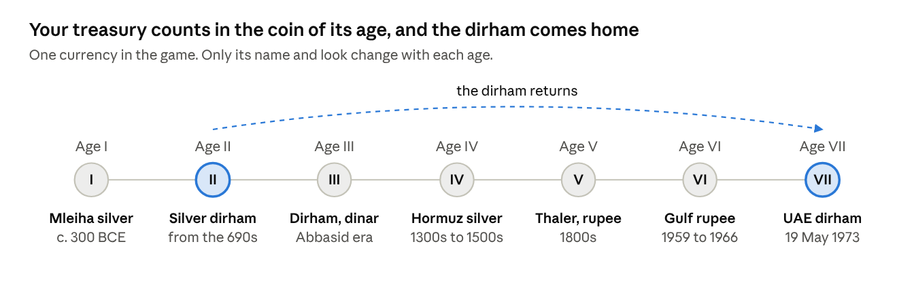

the coin of each age · 7 eras of money in the region

### Only the name and the picture on the coin change. The rules stay the same, so the player never has to learn a new money system. Section 9 explains coin and Dana in full. 

### Age I. The Age of Oases

*About 500 BCE to 630 CE. Coin: silver, including coins struck at
Mleiha. Length: about a day and a half.*

**What happened.** South-eastern Arabia was farmed long before Islam.
What made settled life possible was the falaj, a gently sloping
underground channel that carries water by gravity, sometimes for
kilometres. At Mleiha, in today's Sharjah, silver coins were minted from
around the 3rd century BCE.

**Age's challange.** You want your little town to grow. But every
building needs water, and you only have one well. To grow, you must dig
channels and decide what goes next to them. The best spots are few, and
the land is different every time, so there is no fixed answer.

**What is new.** Building, upgrading, placement bonuses, the water
limit, your first leader, your first caravan, your first rival town,
your first history question.

**Signature mechanic: the falaj.** A water channel is laid as a line
across the grid. Every food building beside it produces 25% more, and
channels can be joined end to end.

**Landmark:** The Great Falaj.

### Age II. The Age of Faith and Law

*About 630 to 800. Coin: the silver dirham. Length: about two and a half
days.*

**What happened.** Islam reached south-eastern Arabia around 630. It
brought a shared faith, a shared law and Arabic as the common language
of government and learning. A merchant could now make a contract in one
city and rely on it in another. The mosque became the centre of town
life, judges applied a common law, and charitable endowments paid for
wells, schools and guest houses. From the 690s the first purely Islamic
coins were struck. Among the earliest from this region were dirhams
minted in Oman.

**How the game presents it.** Islam appears through the things it built:
the mosque at the heart of the town, the judge's court, endowed public
buildings, Arabic script, and the new coinage. The Prophet Muhammad, the
companions and the early caliphs never appear as characters, under the
policy in section 10. *Every piece of Age II content
is reviewed by the historical advisor before it ships.*

**SPECIAL: The coming of Islam: an interactive chapter.**

*Needs approval from the historical advisor and a
qualified religious scholar.*

**What it is.** A short interactive chapter of about ten minutes that
opens Age II. The Rawi narrates. It explains how Islam reached
south-eastern Arabia and how it changed daily life in the town.

**How it works.** Four short scenes, each ending with a light activity:

1.  **The journey of the message.** An illustrated map shows Islam
    spreading from Mecca and Medina across Arabia to Oman and the Gulf
    coast by around 630. The player traces the routes and taps the towns
    as they light up.

2.  **A new calendar.** An interactive timeline shows the hijra of 622
    as year one of the Islamic calendar. From this point the game shows
    both calendars on every date.

3.  **A shared script.** Arabic becomes the common language of
    government, trade and learning. The player completes a geometric
    pattern of the kind used in architecture and calligraphy, then sees
    their town's name written in Arabic.

4.  **A new kind of town.** The player matches the new institutions to
    what they did: the mosque, the judge's court, the public treasury
    and the charitable endowment. Each correct match unlocks that
    building for Age II.

Every activity rewards knowledge and Archive pages. Nothing can be
failed: a wrong match simply shows the right one and explains it.

**What it will not do.** It never shows or gives a voice to the Prophet,
his family, the companions, the early caliphs or any religious figure.
It never uses Quranic text as puzzle material. It never turns worship,
such as prayer, fasting or pilgrimage rites, into a game mechanic or a
score. And it never asks questions of belief with right and wrong
answers. Matters of faith stay in the Archive, in factual, sourced
language.

**Why it matters.** This is the most important historical moment in the
game for our core audience, and the content most likely to be judged.
Done well, it is the strongest proof to cultural funders that the game
treats the region's history seriously. Done carelessly, it is the single
largest reputational risk in the project. That is why it needs both the
historical advisor and a religious scholar before anything is built.

**Why it is engaging.** Players learn by doing rather than reading, and
they leave the chapter with a town that has visibly changed around the
new institutions they have just unlocked.

**Age's challange.** A shared law makes trade safer, so your town grows
quickly. Too quickly. People arrive faster than your institutions can
serve them, and disputes begin. You must decide whether to grow now and
handle disputes as they come, or to build courts and endowments first
and grow more slowly (infrastructure before growth or vice versa).

**What is new.** The mosque as the town's centre, governance capacity,
disputes (section 6), standing, endowments, the second caravan, daily
goals, houses (guilds), and two more rival towns, with all six arriving
by Age III (section 11).

**Signature mechanic: endowments.** You can place coin permanently into
a public building, such as a well or a school, so that it serves the
town forever. You never get that coin back. In return the town gains
permanent standing and governance capacity, and the bonus carries into
every later age. This is the game's first lesson in long-term giving and
investment.

**Landmark:** The Great Mosque and Souq.

**Ends with:** the choice of doctrine (section 10).

### Age III. The Age of Wisdom

*About 800 to 1250. Coin: the dirham and the gold dinar. Length: about
three days.*

**What happened.** In Baghdad, Cairo and Fez, scholars gathered Greek,
Persian and Indian learning and went far beyond it. Al-Khwarizmi's work
on equations gave us the word algebra, and his name gave us algorithm.
Ibn Sina's medical writing was still taught in Europe five centuries
later. None of it happened without rulers who chose to pay for it.

**Age's challange.** Research now gives permanent bonuses that last for
the rest of the game. But research costs coin as well as knowledge, and
you also need coin to promote your leaders. You must decide how much to
invest in the future and how much to spend today.

**What is new.** A larger research tree with branches, permanent
bonuses, instruments for your leaders, and the treasury limit (section
9).

**Signature mechanic: compounding research.** Each branch you complete
raises output in every later age. A player who invests early feels their
town speed up for the rest of the campaign.

**Landmark:** The House of Wisdom.

### Age IV. The Age of Sails

*About 1250 to 1650. Coin: Hormuz silver. Length: about four days.*

**What happened.** The Indian Ocean was the world's busiest
long-distance trade network, and it ran on the monsoon. Ships went east
in summer and came home in winter; miss the season and you waited
months. Ahmad ibn Majid, from Julfar in today's Ras al Khaimah, wrote
sailing guides used for generations. Coins minted at Hormuz have been
found at Julfar. From 1507 Portuguese warships tried to turn open trade
into a monopoly.

**Age's challange.** The best money in the game is now at sea, but the
sea is seasonal and dangerous. You must decide when to sail, which way
to go, and how much damage your ships can take before you stop to repair
them.

**What is new.** Ports and ships, sailing seasons, the choice between
the coast and the open sea (section 12), ship condition and repair, a
foreign fleet event that puts pressure on every town in the region.

**Signature mechanic: sailing seasons.** Sea routes open and close on a
visible calendar. Timing a voyage well is worth as much as choosing it
well.

**Landmark:** The Great Lighthouse.

### Age V. The Age of Pearls

*About 1650 to 1929. Coin: the Maria Theresa thaler and the Indian
rupee. Length: about five days.*

**What happened.** For about two and a half centuries the economy of the
lower Gulf rested on pearls. Every summer, for around four months, the
men left for the pearl banks in what was called the great dive. Divers
went down on a weighted rope with a peg on the nose; haulers on deck
pulled them up. The captain, the nakhuda, ran the boat. Nobody was paid
a wage. Merchants lent to captains, captains lent to crews, and the
catch was shared only after debts were paid. Debts could pass from
father to son, and a diver who fled to another ruler's town to escape
them could cause a quarrel between rulers. The catch was sold to pearl
buyers, the tawwash, and much of it went on to the markets of Bombay.
The fleet's return, the qaffal, was the town's great celebration. The
whole system collapsed at the end of the 1920s.

**Age's challange.** Pearls make you rich quickly, but this age tests
you on three fronts at once. At sea, every extra day of diving is a
gamble. At home, your town is half empty while the fleet is away, and
your rivals know it. And behind it all sits debt: borrow to send more
boats, and a bad season follows you into the next. You must decide how
hard to push, how much to borrow, how much to leave at home, and how
much to keep in other trades before the market turns.

**How a diving season plays.** Four seasons come round in the age. Each
one runs through the same four beats:

1.  **Fit out the fleet.** Choose how many boats to send, which captains
    lead them and how much to borrow against the coming catch. Every
    diver you send is a worker who is not producing at home.

2.  **The great dive.** Each day at sea you choose: bring the catch
    home, or dive one more day. Each extra day makes the whole catch
    worth more and raises the chance of losing that day's take. Events
    break up the days: a storm on the horizon, a diver who finds an
    unusually large pearl, a boat in trouble that asks for help.

3.  **The town alone.** While the fleet is out, home production falls
    and your garrison is thinner. Rivals may raid. Before the season you
    choose how many fighting men stay behind, which means fewer divers
    but a safer town.

4.  **The homecoming.** The fleet returns to celebration. Each pearl is
    graded, and you choose where to sell: to the local pearl buyer now,
    at a fair price, or by sea to Bombay, at a higher price that arrives
    later and moves with the market. Then the crews are paid what they
    are owed.

**Crew debt and runaways.** Crews who end a bad season deep in debt may
flee to a rival town. You can forgive part of the debt, which costs coin
and earns reputation and loyalty. Or you can demand their return, which
costs reputation with that rival and may start a quarrel. This links the
pearl economy to the rivals and to disputes, as it did in history.

**The warning signs.** In the last part of the age, pearl prices start
to slide and the income gauge shows how much you depend on pearls. This
sets up the collapse in Age VI (section 13).

**What is new.** Fleets and captains, the four-beat diving season,
borrowing against the catch, pearl grading and the choice of market,
crew debt and runaways, the savings chest (section 9) and the income
gauge.

**Why it is fun.** Every season is a small story with a beginning, a
gamble, a danger at home and a payoff. The player feels the weight of
the decisions their ancestors faced: how much to risk at sea, who to
leave behind, and whether to sell now or wait for a better price. And
because the market is quietly weakening, the most satisfying seasons of
the game are also the ones that lead toward its greatest upheaval.

**Landmark:** The Great Fort.

### Age VI. The Age of Oil

*About 1930 to 1966. Coin: the Indian rupee, then the Gulf rupee from
1959. Length: about five days.*

**What happened.** The pearl trade did not fade. It collapsed. For about
thirty years the coast lived on rents paid by oil companies for the
right to search, and by airlines for the right to land. Abu Dhabi first
exported oil in 1962 and Dubai in 1969.

**Age's challange.** Your main source of income has just disappeared.
You must rebuild your economy with very little money, while your rivals
do the same. Section 13 explains this age in full.

**Signature mechanic: the upheaval.** A scripted collapse of the pearl
market, followed by a recovery the player plans and builds.

**Landmark:** The Terminal.

### Age VII. The Age of Union

*From 1968. Coin: the UAE dirham, introduced on 19 May 1973. Length:
open.*

**What happened.** In January 1968 Britain announced it would withdraw
from the Gulf by the end of 1971. Nine small states had under four years
to decide their future. After three years of hard negotiation, seven
emirates signed. The federation was declared on 2 December 1971.

**Your problem.** Everything you have built across six ages is now
tested. You choose how your town finishes its story: as the region's
great port, its centre of learning, its protector, or the founder of a
union. Section 16 explains the four endings.

**Landmark:** The Federal Chamber.

## 8. Research

### What it is

Research is how your town learns. Each age has its own research tree.
Finishing the tree's required path is one of the three things you need
to move to the next age.

### How it works

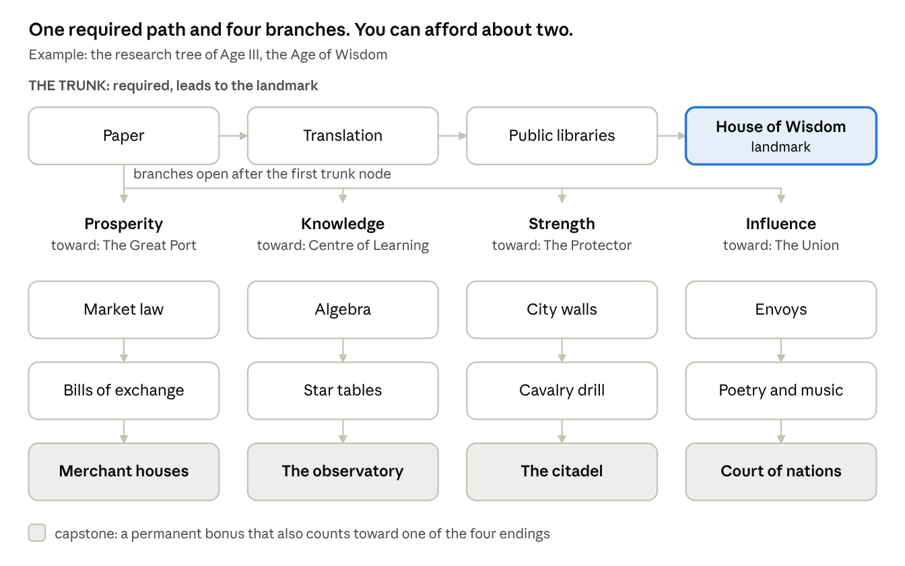

research tree of one age · 1 required path, 4 branches

Every tree has two parts:

- **The trunk.** Three or four nodes in a fixed order. The last one
  unlocks the age's landmark. Every player follows the same trunk.

- **Four branches.** Each has two nodes and a capstone. The branches are
  the same four in every age: Prosperity, Knowledge, Strength and
  Influence. Only their content changes with the history.

Each node costs knowledge. From Age III onward, nodes also cost some
coin. Research takes real time, from five minutes in Age I to about
three hours in Age VI. You can run one research at a time at first, and
two later.

Age I is simpler on purpose. It has the trunk and only two branches,
Prosperity and Strength. All four branches open in Age II.

### The choice it asks for

In a normal age, you earn enough knowledge to finish the trunk and about
two of the four branches. You cannot have everything. So in each age you
choose:

1.  **Which branches suit your plan.** A merchant town wants Prosperity.
    A town surrounded by hostile neighbours wants Strength.

2.  **Whether to stay longer.** You can remain in an age to finish a
    third branch. But every day you stay is a day not spent in the next
    age, where everything earns more.

3.  **Where you are heading.** Each capstone gives a permanent bonus and
    also counts toward one of the four endings in section 16. Over seven
    ages, your research choices decide which ending is within reach.

A worked example: in Age III a player has three rival towns that raid
often and a doctrine of Merchants. They take Strength to stop the raids
and Prosperity because it suits their doctrine. They skip Knowledge and
Influence. In Age IV the raids stop, so they switch to Influence and
start winning their neighbours over.

### Why it matters

Research ties the whole game together. It gates the age change, it
shapes your town's strengths, and it points you toward an ending.
Without it, every player's town would end up the same.

### Why it is fun

The choice is small enough to make in a minute and big enough to matter
for a week. Every age asks the question again, with new circumstances.
And because the capstones add up, a player can look back across seven
ages and see the civilization they chose to build.

### Why this design beats the alternatives

| Approach                                                 | What is good about it                                                    | Why we did not choose it                                                                                                                          |
|----------------------------------------------------------|--------------------------------------------------------------------------|---------------------------------------------------------------------------------------------------------------------------------------------------|
| One fixed list per age                                   | Very easy to learn                                                       | No choices. Every player ends up with the same town.                                                                                              |
| A large web of dozens of nodes, as in big strategy games | Deep and flexible                                                        | Too much to read on a phone in a four-minute visit. Most players would stop looking at it.                                                        |
| Random research cards each age                           | Surprise                                                                 | Players cannot plan. People who work toward a goal feel cheated.                                                                                  |
| **One trunk and four branches (our choice)**             | **A guaranteed way forward, plus a real choice that fits on one screen** | Players can only see one age's tree at a time. We show the capstones from earlier ages on the same screen so the long-term picture stays visible. |

The trunk guarantees that nobody gets lost. The branches make sure no
two towns are the same. And because the four branches line up with the
four endings, every small research decision feeds the biggest decision
in the game.

## 9. Money

The economy runs on one main currency, coin, plus one premium currency,
Dana. Everything else in this section explains how coin moves through
the game and why that movement keeps the game interesting.

### Coin and Dana

|                              | Coin                                                            | Dana                                                                                                 |
|------------------------------|-----------------------------------------------------------------|------------------------------------------------------------------------------------------------------|
| **What it is**               | The money your town earns                                       | A premium currency named after a single large, perfect pearl                                         |
| **How you get it**           | From buildings, routes, trade, rivals, events                   | Bought with real money. Small amounts are also earned from achievements and league rewards.          |
| **What it buys**             | Almost everything: buildings, research, promotions, repairs     | Time, convenience and looks: speed-ups, one extra route, cosmetics. It can also be turned into coin. |
| **Can it be converted?**     | Coin can never buy Dana                                         | Dana can buy coin                                                                                    |
| **Its name changes by age?** | Yes: silver, dirham, Hormuz silver, rupee and so on (section 7) | No                                                                                                   |

**Why we need both.** Two reasons. First, the price of a small purchase
means very different things in Dubai and in Cairo. With a premium
currency we set the amount of Dana once and change only the local price,
so the game economy stays the same everywhere. Second, it keeps a clean
line between what play earns and what money buys. Coin is the game. Dana
buys time and comfort, never victory.

### Fewer currencies

The game uses as few currencies as possible, so players always know what
their money is worth. Everything in the town, from ship repairs to oil
buildings and rare items, is paid in coin. The treasury limit below
stops coin from piling up. The only other currency is event tokens,
which exist during a single event and vanish when it ends.

### The treasury limit

You asked whether coin should have a cap. We looked at three options.

| Option                                                      | What it does well                                  | What goes wrong                                                                                     |
|-------------------------------------------------------------|----------------------------------------------------|-----------------------------------------------------------------------------------------------------|
| No limit                                                    | Simple. Nothing ever feels lost.                   | Coin piles up endlessly. Rewards stop feeling like rewards, and we need extra currencies to fix it. |
| A hard limit, coin above it is lost                         | Strong pressure to spend                           | Feels like being robbed. Players resent watching income disappear.                                  |
| **(Our choice) A limit with overflow into a savings chest** | **Pressure to spend, without the feeling of loss** | Needs care so the limit never blocks a purchase the player is ready to make                         |

**How it works.** Your treasury holds coin up to a limit. Upgrading the
treasury building raises it. When the treasury is full, 30% of any
further coin goes into the savings chest instead; the rest is lost. The
game warns you at 90% full and suggests what you could spend on.

Two safety rules. The limit is always at least one and a half times the
price of the most expensive thing you can currently buy. And landmarks
are built in stages, so you pay into them over several visits rather
than needing the whole sum at once.

**Why it matters.** It keeps coin valuable through all seven ages
without extra currencies. It creates a real choice between spending and
saving. And it gives the savings chest a clear purpose.

**Why it is fun.** A full treasury is a prompt to act. Deciding what to
buy, and what to let spill into the chest, is a small decision with
visible results.

### Where money comes from and where it goes

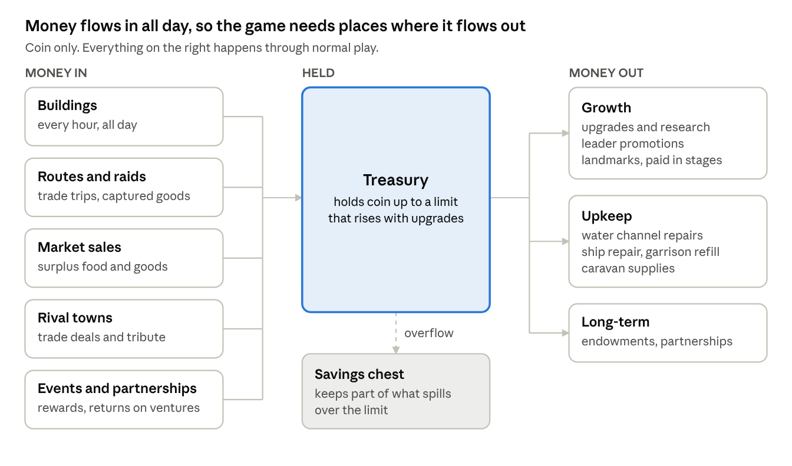

where coin comes from and where it goes · 5 sources, 3 kinds of spending

Read it from left to right. Money comes in from five places, all day
long. It is held in the treasury. It leaves in three ways: growing the
town, keeping it running, and investing for the long term.

The right-hand side matters as much as the left. If money only flows in,
prices stop meaning anything and the game loses its tension. Upkeep is
what keeps a large town from simply printing money: every water channel
needs repairs, every ship gets damaged, every fight costs soldiers.
These costs grow with the town, so they keep pace with income
automatically.

### The pinch point

**What it is.** The moment where the player wants something and cannot
have it yet. Every free game needs one, or nobody would ever pay. If it
is unfair, players quit.

**How it works.** Promoting a leader needs two things at once: fragments
of that leader, which are plentiful, and coin, which is not. From about
day 6, the player sees several leaders ready to promote and not enough
coin to promote them all. They have the people. They do not have the
resources to promote them all.

**Free ways past it:** more routes, the weekly free opening of the
savings chest, daily goals, the weekly league, rewarded videos, fragment
gifts from your house, and fusing spare instruments. **Paid ways past
it:** turning Dana into coin, opening the savings chest in full, or the
Lineage Plan (section 20).

**The rule we hold.** An engaged player who never pays must get past
each pinch point within 48 hours. We measure this directly. If it takes
longer, we add more free coin.

### Money lessons built into play

We decided we wanted the game to teach practical lessons about money
without ever giving a lesson. So the player meets each principle as a
decision in play, and afterwards the game shows them what happened.

| Principle                | Where the player meets it                                                        | What they learn by doing                                                                            |
|--------------------------|----------------------------------------------------------------------------------|-----------------------------------------------------------------------------------------------------|
| Saving versus spending   | The treasury limit and the savings chest                                         | Saving has limits. Money sitting still can be lost.                                                 |
| Timing a sale            | The market: food and goods prices change daily, and peak on market day each week | A patient seller earns more. Selling a lot at once lowers the price.                                |
| Risk and reward          | Coast or open sea, diving one more day, raiding a rival                          | A higher reward usually means a higher chance of loss. The average result is what counts over time. |
| Investing with a partner | Partnerships: you fund a merchant's caravan and share its profit or its loss     | You can earn without doing the work, but you carry the risk. There is no guaranteed return.         |
| Borrowing                | Advances against the diving season                                               | Debt lets you grow faster, and a bad season makes it heavier.                                       |
| Opportunity cost         | The pinch point, the research branches                                           | Every coin spent on one thing is a coin not spent on another.                                       |
| Compounding              | Research bonuses that carry into every later age                                 | Small early investments grow into large advantages.                                                 |
| Diversifying             | Pearls in Age V, then the collapse in Age VI                                     | Depending on one source of income is dangerous.                                                     |
| Long-term giving         | Endowments in Age II                                                             | Some spending pays the community back for ever.                                                     |

**Partnerships, in more detail.** In the history of the region, much
long-distance trade was financed through partnerships: one person
supplied the money, another did the work, and they shared the profit by
agreement, while the investor carried the loss. The game uses the same
idea. You choose a merchant, an amount and a route. When the caravan
returns, you share in what it earned, or you lose part of your stake.
There is no fixed interest. We recommend this form deliberately, because
it fits both the history and the expectations of our main audience. The
historical advisor should confirm the wording.

**The ledger.** Once a week the game shows a one-screen summary: where
your coin came from, where it went, what your partnerships returned and
how much spilled over your limit. It is optional and takes ten seconds
to read. It is the closest the game comes to teaching directly, and it
never tells the player what they should have done.

## 10. Leaders, doctrines and instruments

This is the collection part of the game, and the part players grow
attached to. It is also the most sensitive area of the project, because
it uses real historical people.

### How the court works

You choose one ruling leader and up to four court members. The ruling
leader's abilities are stronger. Every leader has:

- a **passive ability** that works all the time, such as more knowledge
  or cheaper buildings;

- an **active ability** you tap, which then needs time to recharge;

- an **age** they belong to, which gives a bonus while you are in that
  age;

- a **doctrine** they suit, which gives a bonus when it matches yours.

### Doctrines and resonance

**What it is.** At the end of Age II you choose a doctrine: the kind of
civilization you want to be. Each of the twelve leaders suits one
doctrine, because of who they were. When your doctrine matches a
leader's, that leader resonates.

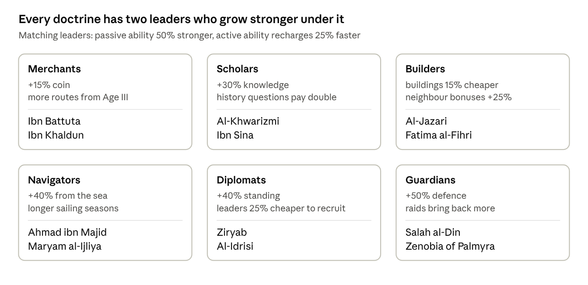

doctrines and their leaders · 6 doctrines, 12 leaders

**How it works.** A resonating leader's passive ability is 50% stronger
and their active ability recharges 25% faster. A leader who does not
match still works at full normal strength. Nothing is ever switched off.

**Why each pairing makes sense.** Ibn Battuta crossed three continents
with trade caravans, and Ibn Khaldun wrote some of the earliest analysis
of prices, taxes and labour. Al-Khwarizmi and Ibn Sina are the two great
scholars of the roster. Al-Jazari built machines, and Fatima al-Fihri
founded and funded a university. Ahmad ibn Majid was a navigator, and
Maryam al-Ijliya made astrolabes, the instruments for reading the stars.
Ziryab carried the culture of Baghdad to the court of Cordoba, and
Al-Idrisi drew his world map for the king of Sicily. Salah al-Din and
Zenobia both led armies in defence of their lands.

**Why it stays balanced.** Every doctrine has exactly two resonant
leaders, and the bonus is the same size for all of them. No leader is
required to win, and no doctrine has more support than another.

**Combinations we checked.** Equal bonuses are not enough on their own,
because some pairs multiply each other. We tested every doctrine with
its two leaders and found six combinations that would break the game:

| Combination                                                                | The problem                                                                                         | The fix                                                                                               |
|----------------------------------------------------------------------------|-----------------------------------------------------------------------------------------------------|-------------------------------------------------------------------------------------------------------|
| Scholars with Al-Khwarizmi and Ibn Sina, plus Fatima al-Fihri in the court | Knowledge bonuses multiplied to about three times normal, so the player could rush through the ages | Bonuses of the same kind now add together, and the total from leaders and doctrine is capped at +100% |
| Al-Jazari under Builders                                                   | +45% to every building, the strongest bonus in the game                                             | Lowered to +20%, or +30% when resonating                                                              |
| Salah al-Din and Zenobia under Guardians                                   | A full garrison restore in a 15-second fight made losing almost impossible                          | Relief now restores half the garrison, once per fight                                                 |
| Ahmad ibn Majid under Navigators                                           | Ignoring storms often enough removed the risk from the open sea                                     | Book of Benefits works at most once a day                                                             |
| Ziryab under Diplomats                                                     | Turning plentiful reputation into coin got around the pinch point                                   | A fixed rate, once a day                                                                              |
| Ibn Battuta under Merchants                                                | Two extra caravan slots doubled route income early on                                               | His third slot stays; when resonating, his caravans return 15% faster rather than adding another slot |

**The rules behind the fixes.** Bonuses of the same kind add together
before they are applied. No resource can be raised by more than 100%
from leaders and doctrine combined. Abilities that remove risk recharge
no faster than once a day, so the risk choices stay real. And abilities
that finish a task instantly cannot be combined with a paid speed-up on
the same task.

**Why it matters.** It turns the doctrine from a single number into a
reason to build a particular court. Two players with the same leaders
will play differently if they chose different doctrines.

**Why it is fun.** It gives the collection a direction. A player who has
chosen Navigators knows which two leaders to chase. And because every
new lineage in the endgame (section 16) must choose a different
doctrine, the best court changes each time, which brings players back to
leaders they had set aside.

### The twelve launch leaders

Twelve historical figures make up the court at launch, two for each
doctrine. The roster covers all six doctrines, ages I to IV, and
includes three women. Each is widely celebrated across the region, died
more than two hundred years ago and has no reigning dynasty. The Age
column shows each leader's home age, the period they lived in. A leader
can join your court in any age, once you have collected enough of their
fragments, so both leaders for your doctrine are available from the
moment you choose it at the end of Age II. In their home age a leader is
25% stronger, which gives players a reason to change their court as the
ages pass.

**How leaders arrive.** Choosing a doctrine brings one of its two
leaders to your court at once. Fragments for the second drop twice as
often until they join, usually within three days. Every other leader's
fragments drop most often as their home age approaches. So a player in
Age III will normally have their doctrine's pair, but may still be
collecting the navigators and travellers who belong to Age IV.

Three ideas work together here. **Fragments** are pieces of a particular
leader; collect enough and that leader joins you. Your **doctrine**
decides which two leaders resonate with you. A leader's **home age** is
when they are strongest. Here is an example from gamplay:

1.  **Day 1, Age I.** The Rawi gives you Zenobia. She is your first and
    only leader.

2.  **Days 1 to 3.** Your routes and history questions bring back
    fragments for different leaders. Each leader needs 10 fragments and
    a little reputation to join. On day 3 you collect Al-Khwarizmi's
    tenth fragment, and he joins your court.

3.  **Day 4, end of Age II.** You choose the Merchants doctrine. Ibn
    Battuta, one of its two leaders, joins at once. Fragments for Ibn
    Khaldun, the other, now drop twice as often, and he joins on day 6.

4.  **From day 6.** Battuta and Khaldun both match your doctrine, so
    they resonate: their passive abilities are 50% stronger and their
    active abilities recharge faster. Zenobia and Al-Khwarizmi still
    work at normal strength.

5.  **Day 9, Age IV.** Battuta and Khaldun are now in their home age, so
    they are stronger again. Ahmad ibn Majid's fragments start dropping
    more often, because Age IV is his age too, and he joins on day 10.

6.  **At any point.** Extra fragments of a leader you already have, plus
    coin, promote that leader to a higher level. This is where coin
    becomes scarce, as section 9 explains.

| Leader             | Age | What they actually did                                                      | Passive ability                                                                 | Active ability                                                                                                | Doctrine   |
|--------------------|-----|-----------------------------------------------------------------------------|---------------------------------------------------------------------------------|---------------------------------------------------------------------------------------------------------------|------------|
| Zenobia of Palmyra | I   | Ruled the caravan city of Palmyra and led its armies against Rome           | +25% coin from caravans                                                         | Desert column: the next route ignores all travel hazards, but not fights                                      | Guardians  |
| Ziryab             | II  | Brought the music and manners of Baghdad to Cordoba                         | +30% standing                                                                   | Court of musicians: turns reputation into coin at a fixed rate, up to a quarter of a day's income, once a day | Diplomats  |
| Al-Khwarizmi       | III | His book on equations gave us the word algebra                              | +35% knowledge                                                                  | Algorithm: finishes the current research at once                                                              | Scholars   |
| Ibn Sina           | III | Wrote a medical book taught in Europe for 500 years                         | +25% population growth, half as many epidemics                                  | The Canon: clears all bad events                                                                              | Scholars   |
| Al-Jazari          | III | Designed water clocks and programmable machines                             | +20% output from every building                                                 | Automata: every building yields 30 minutes of output                                                          | Builders   |
| Fatima al-Fihri    | III | Founded al-Qarawiyyin in Fez, among the oldest universities still open      | Knowledge buildings +50%, 20% cheaper                                           | Endowment: one knowledge building, free                                                                       | Builders   |
| Maryam al-Ijliya   | III | Made astrolabes for the court of Aleppo                                     | +25% from crafts and instruments                                                | Astrolabe: lengthens the current sailing season                                                               | Navigators |
| Salah al-Din       | III | United Egypt and Syria and defended them                                    | +30% defence, rival raids 25% less likely                                       | Relief: restores half your garrison, once per fight                                                           | Guardians  |
| Al-Idrisi          | IV  | Made one of the great world maps of the Middle Ages                         | Travel hazards and decision outcomes shown before you send, never fight results | Tabula: opens one extra route for 24 hours                                                                    | Diplomats  |
| Ahmad ibn Majid    | IV  | The Gulf's most celebrated navigator, from Julfar in today's Ras al Khaimah | +40% from sea voyages                                                           | Book of Benefits: the fleet ignores the next storm, once a day                                                | Navigators |
| Ibn Battuta        | IV  | Travelled further than almost anyone of his century                         | A permanent third caravan slot                                                  | Rihla: completes any route in progress                                                                        | Merchants  |
| Ibn Khaldun        | IV  | Wrote a history of civilizations that explained how economies rise and fall | +35% legacy when the age changes                                                | Muqaddimah: shows the next age's opening bonuses                                                              | Merchants  |

### Court officers

Ages V, VI and VII are covered at launch by court officers: unnamed
characters such as the ship's captain (nakhuda), the pearl buyer
(tawwash), the water-channel master, the caravan guide, the falconer,
the scribe, the midwife and the fort captain. They fill court slots, are
cheaper to make, and help named leaders feel rare.

The nineteenth-century rulers of the Trucial coast are the figures a
Gulf audience will most want. They are planned for the first expansion
(DLC), once advisory approval is in place, so the launch does not wait
for permissions.

### The rules on real people

| Group | Who                                                                                                                                           | Rule                                                                                                 |
|-------|-----------------------------------------------------------------------------------------------------------------------------------------------|------------------------------------------------------------------------------------------------------|
| A     | Died more than 200 years ago, no reigning dynasty, widely celebrated                                                                          | Free to use. All twelve launch leaders.                                                              |
| B     | Rulers of the Trucial States in the 19th and 20th centuries                                                                                   | Only with the advisor's approval and, where needed, written permission. Never essential to progress. |
| C     | The Prophet Muhammad and all prophets, the companions, the early caliphs, the Shi'a Imams, any living person, any member of a reigning family | Never a character in the game. May be mentioned factually in the Archive.                            |

Every leader has a sourced Archive page. We never invent dialogue for
real people, and every ability is based on something they actually did.

### Instruments 

**What it is.** Each leader carries one tool, and the tool changes how
their abilities work. There are nine kinds, all real historical objects:
the khanjar dagger, the matchlock, the camel staff, the kamal and
pilot's book, the astrolabe, the diving kit, the falcon, the scribe's
case and the falaj tools.

**How it works.** Each tool comes in five qualities: plain, fine,
master, named and storied. A better quality is a stronger version of the
same effect, never a different effect, so the player never has to
relearn what a tool does. You raise a tool's quality by fusing spare
tools into it, which also costs coin. The top quality, storied, unlocks
an Archive page about the real object.

**Why it matters.** Nine tools in five qualities give the player
forty-five things to collect, for about 1.6 times the art cost of nine.
Fusion gives duplicates a use and removes coin from the economy.

**Why it is fun.** You can keep a favourite tool for the whole campaign
and keep making it better, across seven ages in which almost everything
around it changes.

## 11. The region: rivals, conflict and diplomacy

### What it is

Your town shares a region with six rival towns. The game runs them. Each
has its own character, its own strength and its own feelings about you.
You can trade with them, raid them, defend against them, help them or
win them over. They also act on their own, whether or not you are
playing.

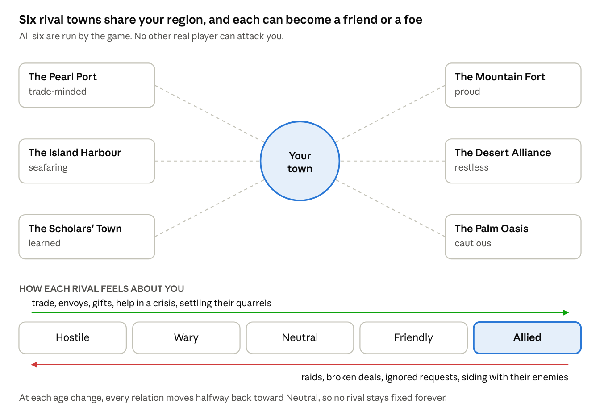

the region · your town, 6 rivals, 5 levels of relations

The six rivals are invented towns, each based on a real type of
settlement in the region's history: a pearling port, an island harbour,
a town of scholars, a mountain fort, a desert alliance and a farming
oasis. They are deliberately not real emirates, cities or tribes. That
keeps the game away from present-day politics and family histories.
Their names will be reviewed by the historical advisor.

### How it works

**Relations.** Each rival sits somewhere on a five-step scale, from
hostile to allied. What you do moves them along it, as the picture
shows. Their character matters too: a proud town forgives slowly, a
trade-minded town warms quickly to good deals.

**What you can do.** Every action uses one of your caravan slots, so it
competes with ordinary trade.

| Action                              | What you spend         | What happens                                                         | Effect on relations                 |
|-------------------------------------|------------------------|----------------------------------------------------------------------|-------------------------------------|
| Trade                               | Goods and a caravan    | You earn coin, more if they like you                                 | Up a little                         |
| Send an envoy                       | Standing, a gift       | Opens new deals and alliances                                        | Up                                  |
| Raid                                | Part of your garrison  | A short fight. Win, and you take goods. Lose, and you lose soldiers. | Down sharply. They may strike back. |
| Help in a crisis                    | Food, coin or soldiers | Answers a request they sent you                                      | Up sharply                          |
| Settle a quarrel between two rivals | Standing               | Both rivals owe you                                                  | Up with both                        |

**What they do on their own.** Every few hours each rival takes one
action: it offers you a deal, asks for help, quarrels with another
rival, grows, or raids someone. A hostile rival is more likely to raid
you. A friendly one is more likely to offer you trade. When you open the
game, step 1 of the loop shows you what happened while you were away.

**Fights.** All fights are short, about fifteen to twenty seconds, and
follow one rule: riders beat bowmen, bowmen beat shield-bearers,
shield-bearers beat riders. You always see the enemy's mix before you
commit, so the choice is real and readable. You may tap up to two leader
abilities during the fight. There are three kinds:

- **Defending** when a rival raids you. If you win, they lose strength.
  If you lose, they take some of your goods.

- **Raiding** a rival. One fight. If you win, you take goods.

- **A campaign** against a rival, from Age III onward. Three fights over
  a day. Win two, and the rival accepts your protection and pays you a
  yearly tribute. This is the forceful way of bringing a rival under
  your influence.

**Bringing a rival into your sphere.** There are four ways, and each one
matches a branch of research and one of the four endings:

| Way        | What it takes                                    | The rival becomes               |
|------------|--------------------------------------------------|---------------------------------|
| Prosperity | Trade with them until they depend on your market | Your trade partner              |
| Knowledge  | Their students come to study in your town        | Part of your circle of learning |
| Strength   | Win a campaign against them                      | A town under your protection    |
| Influence  | Reach Allied and sign a pact                     | Your ally                       |

**How each rival responds to each approach.** Every rival is easier to
win over in some ways than others, based on its character. We set this
up so that no ending has an advantage: for each of the four approaches,
exactly two rivals are easy, two are normal and two are hard. An ending
needs four of the six, so every ending can be reached with the two easy
rivals and the two normal ones, and every ending can leave out its two
hard ones.

| Approach       | Easy, about 3 days             | Normal, about 5 days            | Hard, about 10 days             | Leaders and doctrines that help                                              | What keeps it fair                                                                                                                          |
|----------------|--------------------------------|---------------------------------|---------------------------------|------------------------------------------------------------------------------|---------------------------------------------------------------------------------------------------------------------------------------------|
| **Prosperity** | Pearl Port, Island Harbour     | Scholars' Town, Palm Oasis      | Mountain Fort, Desert Alliance  | Merchants with Ibn Battuta and Ibn Khaldun; Zenobia; Builders and Navigators | A rival's relation can rise only so far each day, so extra caravan slots never speed up progress with one rival                             |
| **Knowledge**  | Scholars' Town, Palm Oasis     | Pearl Port, Mountain Fort       | Island Harbour, Desert Alliance | Scholars with Al-Khwarizmi and Ibn Sina; Fatima al-Fihri; Builders           | Students come only when your learning is higher than the rival's and relations are at least Neutral. Knowledge bonuses are capped at +100%. |
| **Strength**   | Pearl Port, Palm Oasis         | Island Harbour, Desert Alliance | Scholars' Town, Mountain Fort   | Guardians with Salah al-Din and Zenobia; Navigators                          | A campaign needs three successful raids first, once per rival per age. No ability reveals or removes the risk of a fight.                   |
| **Influence**  | Mountain Fort, Desert Alliance | Scholars' Town, Island Harbour  | Pearl Port, Palm Oasis          | Diplomats with Ziryab and Al-Idrisi                                          | The same daily limit on relations. Ziryab's reputation-to-coin trade is capped.                                                             |

A hard rival is never impossible. It simply costs about twice as much
effort. Rivals also grow with the player: their strength and wealth
scale with the player's age and town level, so a strong player cannot
simply roll over them and a weaker player is never crushed.

**Doctrines and endings.** Four doctrines lean naturally toward one
ending each: Merchants toward the Great Port, Scholars toward the Centre
of Learning, Guardians toward the Protector and Diplomats toward the
Union. Builders and Navigators would have no natural ending, so their
bonuses count toward two each: Builders toward the Great Port and the
Centre of Learning, Navigators toward the Great Port and the Protector.
No doctrine shortens an ending's requirements. A doctrine only makes the
road toward it a little faster.

### Rivals and each other

The rivals do not only have feelings about you. They have them about
each other, and winning one over can cost you another.

**Old feuds.** Four pairs of rivals start the game in a feud:

| Feud                                       | The cause                                                          |
|--------------------------------------------|--------------------------------------------------------------------|
| The Pearl Port and the Island Harbour      | They compete for the same trade                                    |
| The Island Harbour and the Desert Alliance | Desert raiders strike caravans carrying the harbour's goods inland |
| The Scholars' Town and the Mountain Fort   | An old quarrel over who rules the wadi between them                |
| The Scholars' Town and the Palm Oasis      | A dispute over an endowment that pays for the oasis water channels |

Two pairs start as friends: the Pearl Port and the Palm Oasis, which
feeds it, and the Mountain Fort and the Desert Alliance, which guard
each other's passes.

We placed the feuds so that every ending meets exactly two of them among
its easy and normal rivals. No ending escapes the problem, and none
suffers it more than the others.

**Jealousy.** When your relations with a rival rise, its enemy notices.
Every gain with one rival costs you a quarter of that gain with each of
its enemies. Gains with a rival's friend come with a small bonus
instead.

**Ultimatums.** Once two feuding rivals are both Friendly with you or
better, one of them sends an ultimatum within a few days: drop the
other, or lose us. You have three answers:

| Answer         | What happens                                                                                                                                                          |
|----------------|-----------------------------------------------------------------------------------------------------------------------------------------------------------------------|
| Side with them | The other rival falls to Wary with you and stops cooperating                                                                                                          |
| Refuse         | The rival who sent the ultimatum falls to Neutral and leaves your sphere if it was in it                                                                              |
| Mediate        | A three-step task costing reputation and coin. If it succeeds, the feud cools for the rest of the age and the jealousy stops. If it fails, both rivals fall one step. |

Diplomats, Influence capstones, Ziryab and Al-Idrisi make mediation
cheaper and more likely to succeed. That is the Influence path's
particular strength: it can resolve the feuds that slow down every other
path.

**Feuds that change.** Rivals act on each other as well as on you. They
trade, raid and form alliances on their own, and their feelings shift.
Old feuds do not fade at an age change unless you have mediated them,
but new quarrels can start, often during the upheaval of Age VI, when
desperate towns turn on each other.

**Ages.** Rivals move through the ages with you, and their towns change
with the times. At each age change, every relation moves halfway back
toward neutral. Old friendships fade a little and old grudges cool, so
the region never freezes.

**Introducing it gently.** The first rival appears on day 1, as a
friendly trading neighbour. Two more arrive in Age II, and all six by
Age III. Trading and defending come first. Raiding opens once the player
has chosen a doctrine, and campaigns open in Age III.

### Why it matters

It gives the game the conflict, without making it a war game. It gives
standing and the garrison a real use. It makes the region feel alive.
And it is the stage on which the four endings play out.

### Why it is fun

Neighbours with names and moods make stories. The town you raided in Age
II remembers it in Age III. The oasis you saved from famine sends you
its best students. And every rival poses the same open question: will
you win them by trade, learning, strength or friendship?

### How it fits the history

Raiding was part of life in the region, but it was a contest over
camels, goods and standing, with strong customary limits, and it was
settled by mediation and compensation as often as by force. Settled
oases often paid desert groups for protection. Alliances formed and
broke as interests changed. The game follows all of this. It does not
depict attacks on civilians, and it does not cast the player as a
pirate, because that label, applied by the British to the Qawasim, is
still disputed. The Archive explains both sides.

### What it adds to the build

The rivals run on a simple set of rules on our server, checked every few
hours. There is no real-time play to synchronise. We estimate it adds
about six weeks of design and engineering to the soft-launch build,
which section 21 includes in the costs.

## 12. Routes and risk

The active part of the game is sending routes and deciding how much risk
to take. This section explains routes, then the most important risk
choice in the game, rebuilt from the ground up.

### Routes

A route is a trip you send out from your town: a caravan by land, or a
ship by sea from Age IV. You choose where it goes, which leaders travel
with it and how long it lasts. While it travels, it may stop at two to
four decision points, where you choose between a safer and a riskier
option. When it returns, it brings coin, leader fragments and sometimes
a page for the Archive.

There is no energy meter. Instead, you set your own timer by choosing
the length of the trip:

| Trip          | Length                                    | What it brings                           |
|---------------|-------------------------------------------|------------------------------------------|
| Short errand  | 8 minutes                                 | A little, safely                         |
| Day caravan   | 2 hours                                   | A fair amount                            |
| Long caravan  | 6 hours                                   | A lot, with one extra decision point     |
| Season voyage | 14 hours, sea only, in the sailing season | The most, with two extra decision points |

A player with ten minutes sends a short errand. A player going to bed
sends a season voyage. Section 20 explains how route timers can also be
shortened with Dana.

### How many routes at once

The number of routes you can have out at the same time grows with the
ages. Your doctrine adds to it from Age III, depending on the kind of
civilization you are building.

| Age        | Every player | Merchants | Navigators     | Diplomats                 | Guardians         | Scholars and Builders |
|------------|--------------|-----------|----------------|---------------------------|-------------------|-----------------------|
| I          | 1            |           |                |                           |                   |                       |
| II         | 2            |           |                |                           |                   |                       |
| III        | 2            | +1        |                | +1 for rival actions only |                   |                       |
| IV         | 3            | +1        | +1 at sea only | +1 for rival actions only | +1 for raids only |                       |
| V          | 3            | +2        | +1 at sea only | +1 for rival actions only | +1 for raids only |                       |
| VI and VII | 4            | +2        | +2 at sea only | +1 for rival actions only | +1 for raids only |                       |

So a Merchants player in Age VII can have six routes out at once,
against four for a Scholar. Scholars and Builders get no extra routes
because their strength lies elsewhere: faster research for Scholars,
cheaper and better-placed buildings for Builders.

Two more sources add one route each, for any doctrine: Ibn Battuta in
your court, and the one-time Founder's Caravan purchase (section 20).
Nothing else adds routes.

**Daily limit.** Full rewards are paid for up to 12 routes a day. Only
Merchants raise this, by 2 for each of their extra routes, to a maximum
of 16. The extra routes of other doctrines are limited to the sea, to
rival actions or to raids. They make it easier to fit trips into the
day, but they do not add rewarded trips. Relations with any one rival
can still only rise so far each day, so no doctrine wins rivals faster
through extra routes.

**Why this is balanced.** Routes are the main source of coin, so extra
rewarded routes are a strong bonus. Each doctrine gets one clear
strength of similar size, and none gets two:

| Doctrine   | Its main strength                                                               | What it does not get                  |
|------------|---------------------------------------------------------------------------------|---------------------------------------|
| Merchants  | Up to a third more rewarded routes each day, plus 15% more coin                 | Help at sea, with rivals or in fights |
| Navigators | 40% more from the sea, longer sailing seasons, extra sea routes for timing      | More rewarded routes                  |
| Diplomats  | 40% more reputation, cheaper leaders, an extra route for rival actions          | More rewarded routes                  |
| Guardians  | 50% more defence, richer raids, an extra route for raids                        | More rewarded routes                  |
| Scholars   | 30% more knowledge and double rewards from history questions, so faster ages    | Extra routes                          |
| Builders   | Buildings 15% cheaper and stronger neighbour bonuses, so the town grows fastest | Extra routes                          |

Merchants' coin bonus drops from 30% to 15% because their extra routes
already give them more coin. Without that cut they would earn far more
than any other doctrine.

### The coast or the open sea

- **Heading:** the direction a ship sails. From Age IV, every sea voyage
  asks you to pick one of two.

- **Hull:** the body of the ship. Every ship has a hull condition from 0
  to 100.

- **Reef:** coral and rock just under the surface near the shore.
  Hitting one damages the hull.

- **Storm:** bad weather far from land. A storm can wash cargo
  overboard.

**What it is.** Every sea voyage asks the same question: hug the coast,
or sail straight across open water? The coast is shallow and full of
reefs. The open sea is faster to richer markets, but exposed to storms.
The two routes carry different kinds of danger, not just different
amounts of it.

**How it works.**

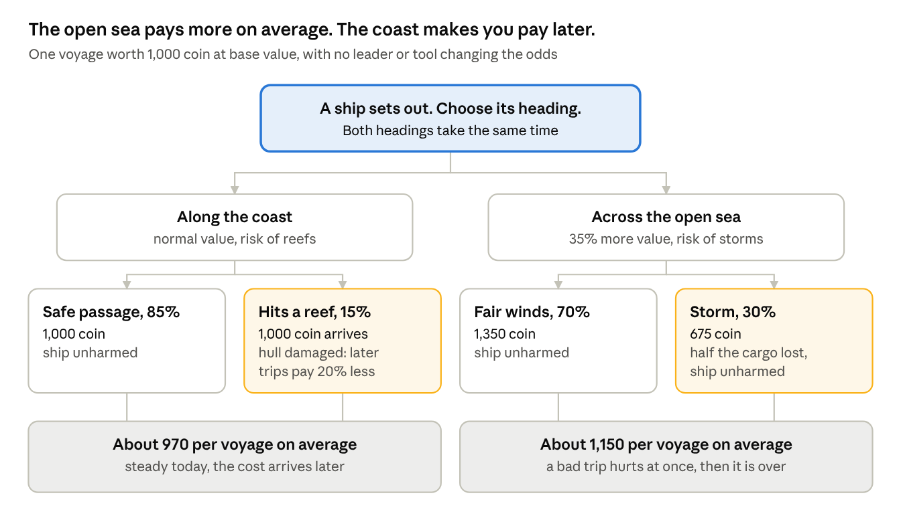

one voyage, two headings · 4 possible outcomes

Read it from the top. The coast never loses cargo, but one voyage in
seven damages your hull. A damaged hull earns 20% less on every later
voyage until you pay 200 coin and wait one hour to repair it. The open
sea earns more, but nearly one voyage in three loses half its cargo. The
hull is never harmed.

The key difference is **when you pay**. On the coast, you pay later and
you keep paying until you repair. On the open sea, a bad trip costs you
once, at once, and then it is over.

**When each one is the better choice.**

| Your situation                                                       | Better choice | Why                                                         |
|----------------------------------------------------------------------|---------------|-------------------------------------------------------------|
| You need a sure amount today, for example to finish a landmark stage | Coast         | It never loses cargo today                                  |
| Your treasury is low and a lost cargo would hurt                     | Coast         | Steady income now                                           |
| Your hull is already damaged and you cannot repair yet               | Open sea      | Another reef would make every trip worse                    |
| You are planning many voyages this week                              | Open sea      | Over many trips, the higher average wins                    |
| The sailing season is ending and storms are forecast                 | Coast         | Storm chance rises from 30% to 45% at the end of the season |

**What changes the odds.** Leaders and tools shift the numbers, which is
part of what makes them worth collecting. The kamal and pilot's book cut
the reef chance from 15% to 5%. Ahmad ibn Majid can make the fleet
ignore the next storm. Hull research reduces reef damage. A storm
forecast appears near the end of each sailing season.

**Why it matters.** It turns every voyage into a judgement about your
own situation, rather than a test of whether you are a careful or a bold
person. The right answer changes from day to day, so the question never
gets stale.

**Why it is fun.** The player is reading their own town: How strong is
my hull? How much do I need today? Is the season ending? And it is
historically true. The lower Gulf coast really was shallow and
reef-strewn, which is why local pilots and written sailing guides were
so valuable.

### Other risk choices

The same rule, a riskier option that pays 10% to 20% more on average,
applies to every other risk choice in the game:

- **The diving season** (Age V). Each day, bring the catch home or dive
  one more day. Each extra day makes the whole catch worth more and
  raises the chance of losing that day's take.

- **The savings chest.** Open it now, or wait for it to fill and risk
  the weekly reset.

- **When to change age.** Move now, or stay a day to finish another
  research branch.

- **Committing reserves in a fight.** A bigger reward if you win, a
  bigger loss if you do not.

- **Partnerships.** A larger stake earns a larger share, and loses more
  if the caravan fails.

## 13. The upheaval: when the pearl market collapses

### What it is

At the start of Age VI, the pearl market collapses, as it really did
around 1930, when the world depression and cheap Japanese cultured
pearls arrived at the same time. Your income from pearls drops sharply
and permanently. You then rebuild your economy around new sources: rent
from oil companies, fees from the airfield and, at the end of the age,
the first oil exports.

### How it works

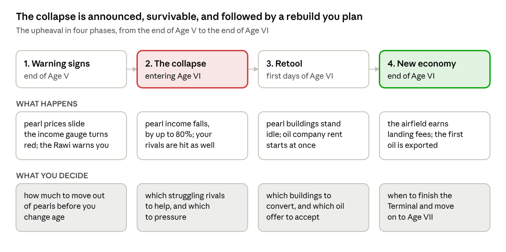

the upheaval · 4 phases across Ages V and VI

**What triggers it.** The player does. The collapse happens when you
choose to leave Age V, and you choose when that is. It is never a
surprise, because the game warns you three times:

1.  In the last part of Age V, pearl prices on the market start to
    slide, and a gauge shows how much of your income comes from pearls.

2.  The Age V chapter of the Chronicle, which you must finish to leave
    the age, tells the real story of the collapse.

3.  Before you confirm the age change, the Rawi tells you plainly what
    is about to happen.

**How hard it hits.** The loss depends on how much you relied on pearls.
Pearl buildings lose 80% of their output. So a player whose income was
80% pearls loses about two thirds of it. A player who kept pearls at 40%
loses about a third. A player who had already moved most of their money
elsewhere barely notices. No player's total income ever falls below one
third of what it was before the collapse.

**Preparing for the collapse.** Once the warnings start, the player can
prepare. Every preparation has a cost, and preparing badly can make the
collapse hurt more than doing nothing.

| Preparation                  | What it costs                                          | Helps because                                                           | Backfires if                                                              |
|------------------------------|--------------------------------------------------------|-------------------------------------------------------------------------|---------------------------------------------------------------------------|
| Move workers out of pearling | Less pearl income now                                  | It lowers your reliance on pearls, the main thing that decides the loss | You do it too early and miss the richest seasons of the age               |
| Sell your pearl stock        | You sell into falling prices                           | Pearls you no longer hold cannot lose value                             | You sell everything at once, which floods the market and drops the price  |
| Build a reserve of coin      | Coin you could have spent on growth                    | It carries the town through the first days of Age VI                    | You save past the treasury limit, and the overflow is lost                |
| Push for one last big season | Nothing up front, because you borrow against the catch | It can earn a lot if the market holds for one more season               | The market breaks first. Then your creditors want the whole debt at once. |

**The traps.** Two mistakes make the collapse worse than doing nothing,
and both are historically true:

- **Holding pearls in the hope that prices recover.** Any pearls still
  unsold when the age changes lose 80% of their value. Many real pearl
  merchants were ruined when the market fell.

- **Borrowing to squeeze out one more season.** When the market breaks,
  every advance you have taken is called in immediately. Whatever you
  cannot repay turns into disputes, lost reputation and crews who leave
  for rival towns.

The income gauge shows all three risks together: how much of your income
comes from pearls, how many unsold pearls you hold, and how much you
owe. The best preparation is gradual. Move out of pearls over the last
few seasons, sell steadily, keep debt low and leave Age V when the gauge
is green.

**What changes in your town.** Your pearl camps, sorting yards and
diving court stand mostly idle. You can convert each one into a modern
building at a discount, and it keeps half its level. Two new sources of
income open at once:

- **Oil concessions.** Oil companies offer you rent for the right to
  search your land. Each offer is a choice: a higher rent now, or a
  lower rent with a larger payment if oil is found.

- **The airfield.** Planes need somewhere to land on the way east. The
  airfield pays a small, steady fee. This is how the coast actually
  survived in the 1930s and 1940s.

**Your rivals.** They are hit too. Some become desperate. Their requests
for help increase, and so do their raids. This is a strong moment for
the Influence path, by helping them, or for the Strength path, by
bringing a weakened rival under your protection.

**Recovery.** The rent starts in the first session of Age VI, so the
player sees the way back immediately. By the end of the age, with the
Terminal built and oil flowing, a typical player earns more than they
did at the height of the pearl trade.

### Why it matters

It gives the whole of Age V its meaning. Every decision to keep money in
other trades, every warning the player heeded or ignored, pays off or
costs at this moment. It is also the clearest lesson in the game about
depending on one source of income.

It carries a real risk: a player who feels punished for something they
could not foresee will quit. That is why the collapse is announced three
times, why its size depends on the player's own choices, why there is a
floor under income and why recovery starts at once.

### Why it is fun

It is the most dramatic moment in the campaign and the one players will
talk about. A player who diversified feels clever. A player who did not
gets a comeback story. And because the collapse depends on choices,
players replaying the campaign in a new lineage approach Age V
differently.

## 14. The Chronicle

### History questions

**What it is.** Knowledge works as a booster. Wherever the game offers
"watch a video for a bigger reward", it also offers a second button:
**answer a question**. A right answer gives the same boost as the video.
The question is always about what the player is doing at that moment,
never general trivia.

**Where the boost is offered.**

| Moment                                             | Boost for a right answer      | The question is about                 |
|----------------------------------------------------|-------------------------------|---------------------------------------|
| Collecting what built up while away                | Double the collection         | The building that produced most of it |
| A route comes home                                 | 50% more cargo                | The place the route visited           |
| A research is running                              | 30 minutes off the timer      | The subject being researched          |
| A leader is promoted                               | A free extra fragment         | That leader's life and work           |
| The diving season, before you bring the catch home | Keep one pearl safe from loss | Pearling and the pearl trade          |

**How it works.** The player chooses: answer, watch a video, or skip. A
right answer gives the full boost. A wrong answer gives a quarter of it
and shows a short explanation, so trying is always worth something. Up
to six knowledge boosts a day give full rewards, separate from the daily
limit on video boosts, so a player who uses both gets the most.

Questions at the age change are different. They are part of the age's
Chronicle chapter, one of the three things needed to move on, and they
are not boosts.

**The trade-off we accept.** Rewarded video is planned as 30% to 45% of
revenue. Some players will answer questions instead of watching videos,
and that revenue will fall. We keep the two limits separate so that
engaged players use both, and we will measure the effect in soft launch.
We think it is worth it: it makes knowing history directly valuable,
which is the point of the game.

**Kinds of question.** Each question takes a few seconds to answer.
There are four kinds:

| Kind                   | Example                                                     |
|------------------------|-------------------------------------------------------------|
| Why something happened | Why did Dubai's trade grow quickly after 1902?              |
| What something was     | Which tool measured the height of a star at sea?            |
| What followed          | The pearl market collapsed around 1930. What mattered most? |
| How something worked   | How did a falaj move water without pumps?                   |

The first kind should be the majority, because it tests understanding
rather than memory. Every right answer also adds a page to the Archive.
A run of right answers earns extra knowledge and Archive pages, but
never a bigger boost, so the boosts stay balanced. There is no penalty
and no timer. The moment this feels like an exam, people stop doing it.

We launch with 400 questions across the seven ages. Each is written by
the historical advisor and checked by a second reader. Questions are
stored on our server, so a factual mistake can be corrected within an
hour. Questions are written separately in Arabic rather than translated,
because a good question in English often needs different wording in
Arabic.

**Why it matters.** It is our clearest difference from every competitor,
and the main reason a cultural institution would want to be associated
with the game.

**Why it is fun.** Knowing something gives you a real advantage. Not
knowing it costs nothing and teaches you something. And the questions
arrive just after the player has done the thing they ask about, so the
history feels connected to the play.

### The Archive

**What it is.** A permanent collection of short pages, 120 to 250 words
each, with one picture and a source. There is a page for every leader,
building, tool, trade good, region and rival type in the game. About 400
at launch.

**How it works.** Pages unlock as you play: from right answers,
returning routes, new buildings and the top quality of each tool.
Completing a set of pages earns legacy and cosmetic rewards.

**Why it matters.** It is the cheapest content we make and the most
valuable to our partners. It is also what we will report to
institutional funders: how many pages players actually read.

**Why it is fun.** Collectors have something to complete, and curious
players have something to read. Nobody is forced to do either.

### When we would scale it back

This is our biggest untested idea, so we set the test in advance. If
fewer than three in ten daily players engage with history questions
during soft launch, we make them less frequent and move them into the
Archive as an optional feature. The rest of the game works without them.

## 15. Progress tracks

### What it is

A progress track is anything in the game the player can move forward on:
their town's level, their leaders, their research and so on. Every
player eventually gets stuck on whatever they are chasing. If that was
the only thing to chase, many would close the app and not come back. So
the game runs nine tracks side by side. When one stalls, the player
moves to another.

### How it works

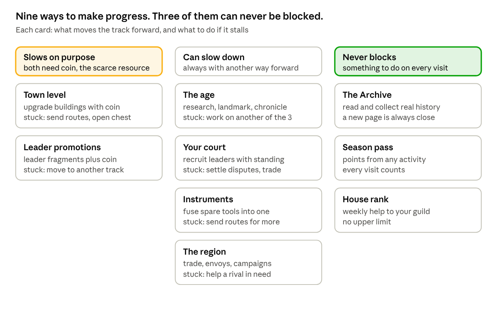

progress tracks · 9 tracks in 3 groups

Read each column as a promise:

- **Slows on purpose.** These two tracks need coin, the scarcest
  resource. When they slow, that is the pinch point at work (section 9).
  It is the moment a player might choose to spend money, and every card
  shows a free alternative.

- **Can slow down.** These four can stall for a while, but each one
  always has another way forward. The age, for example, needs three
  things, so if one is stuck you work on the other two.

- **Never blocks.** These three always move. A player who has run out of
  coin can still read history, earn season points and help their house.

The region is the new ninth track in v4. Your standing with the six
rival towns is always something you can improve, if only by trading.

### Why it matters

A player who is stuck with nothing to do leaves. A player who is stuck
on one thing but busy with another stays, and often finds the stuck
thing has sorted itself out by the time they come back to it.

### Why it is fun

There is always a choice about what to do next, and none of the choices
is a dead end.

### Four kinds of reward

A game can reward time, effort, skill or luck. Idle games usually reward
only time, which is why progress in them can feel unearned. We use all
four.

| Rewarded for | Where it appears                                                                         | What the player feels                 |
|--------------|------------------------------------------------------------------------------------------|---------------------------------------|
| Time         | Production while away, route timers                                                      | Progress even on busy days            |
| Effort       | Season pass, daily goals, house, Archive                                                 | Showing up is worth it                |
| Skill        | History questions, route choices, fight counters, timing the age change, rival diplomacy | I am good at this                     |
| Luck         | Pearl grades, rare tool drops, fights                                                    | Surprise, and something to talk about |

## 16. The endgame: four endings

### What it is

In Age VII the player finishes their town's story in one of four ways.
Each ending matches one of the four research branches and one of the
four ways of winning over a rival town. None of them is simple, because
the rivals feud with each other: to win over the four towns an ending
needs, the player must handle at least two of those feuds along the way
(section 11).

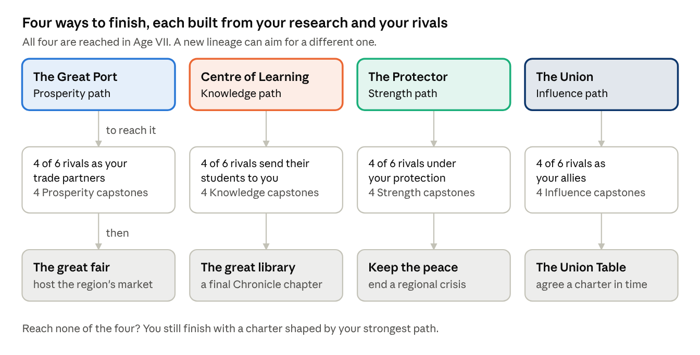

four endings · each needs 4 of 6 rivals and 4 capstones

### How it works

Each ending has two requirements and a final event.

**The requirements.** At least four of the six rival towns must be won
over in that ending's way, and the player must hold at least four
capstones from that ending's research branch, collected across the seven
ages. Requiring four of six, rather than all six, leaves room for a town
that has one stubborn enemy or one ally won another way.

**The final event.** Once both requirements are met, the ending's final
event opens:

| Ending                 | Final event       | What the player does                                                            |
|------------------------|-------------------|---------------------------------------------------------------------------------|
| The Great Port         | The great fair    | Host a three-day market for the whole region and reach a trade target           |
| The Centre of Learning | The great library | Complete a final Chronicle chapter and an Archive collection                    |
| The Protector          | Keep the peace    | A quarrel between two rivals turns into a crisis. End it with a short campaign. |
| The Union              | The Union Table   | Negotiate a charter with your allies before a deadline (below)                  |

**The Union Table**. Seven parties sit at the table, each with three
priorities: seats, revenue, defence, the capital, control of resources
and recognition abroad. The player spends standing, coin and leader
abilities to bring them toward agreement. A party walks out if its red
lines are crossed. The charter can still be signed with fewer members,
for a smaller reward. Outside pressure arrives on a timer, modelled on
what really happened between 1968 and 1971.

**If no ending is reached.** Every player finishes. A player who reaches
the end of Age VII without meeting any ending's requirements receives a
charter shaped by their strongest path. Nobody is left without a
conclusion.

**What an ending gives.** A closing scene for the town, a title for the
lineage, a permanent legacy bonus and a cosmetic that only that ending
unlocks.

### Why it matters

It gives every earlier decision a destination. A research branch chosen
in Age III, a rival saved in Age VI and a doctrine chosen on day 4 all
add up to an ending. It also gives players a reason to play the whole
campaign again.

### Why it is fun

The player chooses what kind of civilization they have built. Four
endings mean four very different campaigns: trading, studying, defending
or negotiating. And each ending is a visible achievement that players
can share.

### After the ending

**Status: Confirmed.** Three systems keep committed players busy for
months:

1.  **A new lineage.** After an ending, the player may start again from
    Age I with a permanent bonus, all their leaders and a different
    doctrine. Each lineage aims at a new ending, and collecting all four
    is the long-term goal. This is what a committed player is still
    doing in month eight.

2.  **Completing the Archive.** Every page collected adds to a long-term
    record, at no extra cost to us.

3.  **The weekly league.** Runs every week, for ever (section 19).

To keep the endgame fresh without endless new content, each six-week
season picks one age and adds a twist to it, such as "Age IV with the
sailing seasons closed", with its own leaderboard.

## 17. The first session

More players are lost in the first ten minutes than anywhere else, so we
design them minute by minute.

### The purpose is not to teach

Most players already know how phone games work. A tutorial they did not
ask for tells them to wait. The purpose of the first session is to make
the player care. Learning follows from that.

### The Rawi

The player meets a guide: the Rawi, a storyteller from the region's
tradition of oral history. He is an invented character, not a historical
person. He opens the game, explains the world in short exchanges, gives
the player their first leader and first tool, and returns briefly at
each age change and the first time each new system appears. He never
says more than three sentences at a time.

The first tool he gives is one the player will still use in Age III. A
gift at the beginning that matters much later is one of the oldest ways
to make a start feel meaningful.

### Minute by minute

The session is built to start high, settle, climb in steps and end on
its highest point.

| Time  | What happens                                                                             | What it introduces                       |
|-------|------------------------------------------------------------------------------------------|------------------------------------------|
| 0:00  | A caravan reaches a dry well. One tap to dig.                                            | Tapping makes things happen              |
| 0:20  | Water flows. The Rawi speaks three sentences.                                            | The tone, the guide                      |
| 0:45  | The player places a date grove. The plot beside the water glows.                         | Placement and neighbours, shown not told |
| 1:15  | An upgrade button shows the jump at level 10                                             | Upgrading                                |
| 2:00  | The Rawi gives the player Zenobia and her camel staff                                    | The court                                |
| 2:30  | The first caravan, with one decision. Both choices succeed.                              | Routes, and the fact that choices exist  |
| 3:30  | The caravan returns with coin and a fragment. A plot opens.                              | Rewards                                  |
| 4:30  | A few riders test the watchtower. The counter is obvious. The player wins.               | Fights                                   |
| 5:30  | The first history question, an easy one about caravans. It opens the first Archive page. | The Chronicle                            |
| 7:00  | The player leaves for 60 seconds and comes back to full stores                           | Production while away                    |
| 8:30  | A second leader is offered. The player picks one of two.                                 | Choice, collecting                       |
| 10:00 | The age's landmark appears on the horizon, out of reach                                  | The long goal                            |

The first rival town arrives later on day 1, once the player has seen
the basics.

### What we deliberately avoid

- A download larger than 150 MB before the first tap.

- Forced account creation or social login.

- A stack of legal screens before the first action, wherever the law
  allows them later.

- A skip button. Players overestimate how ready they are, and skipping
  causes confusion two hours later.

- Long dialogue.

- Any randomness during the first session.

### Should players choose a difficulty at the start?

**Status: Confirmed.** We recommend no difficulty setting at launch, for
three reasons.

1.  **The player cannot choose well yet.** At minute zero they do not
    know what the game is, so they cannot know what difficulty they
    want.

2.  **There is little to make harder.** Nobody loses a town-building
    game. What differs between players is how efficiently they play, and
    a menu setting cannot change that.

3.  **It would slow the team down.** Three difficulties mean three sets
    of numbers to tune and test, on a team of nine.

Instead, players shape their own challenge in three ways: the doctrine
they choose at the end of Age II, optional challenge rules from Age III
that raise costs in return for more legacy, and the many progress tracks
that always offer an easier path. A single harder mode could be added
after launch if players ask for it.

## 18. Player pace: keeping the gap fair

**Status: Proposed.** You asked whether the gap between casual and
committed players was too large. It was. In v3.1 a casual player needed
more than 110 days to reach Age VII, against 47 for an engaged player
and 14 for the most intense. v4 narrows that gap.

### Why there should be a gap at all

Players who put in more should go faster, or effort means nothing. But a
casual player who falls too far behind sees their friends in a different
age, cannot follow the conversation, and gives up. Our target is that a
casual player takes no more than twice as long as an engaged one.

### The three player types we design for

|                                         | Heavy             | Engaged           | Casual              |
|-----------------------------------------|-------------------|-------------------|---------------------|
| Visits per day                          | 15 or more        | 7                 | 3                   |
| Active minutes per day                  | 90                | 38                | 12                  |
| Routes sent per day                     | 12, the daily cap | 6                 | 3                   |
| History questions per day               | 6, the daily cap  | 3                 | 1                   |
| Production collected before stores fill | Almost all        | About 95%         | About 70%           |
| Days to finish Age I                    | 1                 | 1.5               | 3                   |
| **Days to reach Age VII**               | **14** (v3.1: 14) | **21** (v3.1: 47) | **38** (v3.1: 110+) |

A casual player now takes about 1.8 times as long as an engaged one,
down from 2.3. A heavy player is about 1.5 times faster than an engaged
one, down from 3.4.

### How we narrow the gap

1.  **Shorter ages for everyone.** Shorter early ages (section 4) shrink
    every player's journey.

2.  **Daily caps on routes and questions.** These stop the heaviest
    players from racing too far ahead. They apply to everyone equally.

3.  **Storage instead of a slower offline rate.** A player who visits
    three times a day collects most of what their town makes once
    storage is upgraded (section 6). Visiting fifteen times adds little
    over visiting five.

4.  **A welcome-back bonus.** After 12 hours or more away, the next
    three routes bring back 50% more. This helps people with busy days
    without rewarding anyone for staying away.

5.  **Fair league groups.** The weekly league puts players with others
    who play at a similar pace (section 19), so a casual player competes
    with casual players.

### Why it matters

Most of our players will be casual. If the game only works for people
who play constantly, it only works for a small minority. Narrowing the
gap protects retention where most of our audience is.

## 19. Live operations

**Status: Confirmed.** A live game is not a product you ship once. It is
a schedule you run, with something new for players every week.

### Built in layers

We build live operations in five layers and prove each one works before
adding the next. Not all five ship at soft launch, which keeps that
budget down.

| Layer                   | What it is                                                      | Ships at                |
|-------------------------|-----------------------------------------------------------------|-------------------------|
| 0\. The economy         | Everything else rests on it                                     | Vertical slice          |
| 1\. Standing offers     | Dana packs and coin packs                                       | Soft launch             |
| 2\. Conveniences        | Speed-ups, the Founder's Caravan, bigger storage                | Soft launch             |
| 3\. Limited-time events | Monsoon, diving season, Chronicle festival, the majlis          | Soft launch, two events |
| 4\. Regular rhythm      | Weekly league, daily goals, six-week season pass                | Global launch           |
| 5\. Targeted offers     | Offers matched to progress, the savings chest, the Lineage Plan | Global launch           |

The layers should feed each other. During Ramadan, for example, the
season pass pays out tokens used in the parallel majlis event, the event
consumes what the pass gave, a matching offer appears, and an Archive
collection can only be completed by joining both.

### The weekly caravan league

A global leaderboard means nothing to most players: moving from
156,342nd to 136,758th place feels like nothing. So:

- Players compete in **groups of 100**, matched by how much they play
  and how far they have progressed. Never by how much they spend.

- Each league runs **Monday to Sunday**, scored in caravan points that
  change several times a visit.

- There are **seven leagues**: Oasis, Souq, Harbour, Julfar, Hormuz,
  Baghdad and Cairo.

- The **top 15 move up and the bottom 10 move down**. Climbing is
  deliberately easier than falling.

- **Rewards by place**: first place a large reward, places 2 to 5 good,
  6 to 20 medium, 21 to 50 small, 51 to 100 nothing. The empty band
  makes the rest mean something.

- **Each season the top league resets** to Harbour, so the best players
  are never humiliated and the top never stays occupied.

### The calendar

At least one limited-time event a month, ideally one every two weeks. We
plan around the region's own dates as well as global ones, because our
players expect it and because Apple and Google feature regional content
on those dates.

| When                            | Event                                                                                                        |
|---------------------------------|--------------------------------------------------------------------------------------------------------------|
| Ramadan and Eid al-Fitr         | The majlis: our biggest window of the year. Paced for late-night play. No pushy offers during fasting hours. |
| Eid al-Adha                     | Pilgrimage caravans                                                                                          |
| UAE National Day, 2 December    | The Union Table showcase                                                                                     |
| Saudi Founding Day, 22 February | Content about the peninsula                                                                                  |
| Lunar New Year                  | Indian Ocean trade with China                                                                                |
| Nowruz, around 21 March         | Gulf and Hormuz content                                                                                      |
| Monsoon, June and September     | Sea routes pay three times as much for 48 hours                                                              |
| July and August                 | Focused on keeping players, not on revenue. Activity in the region dips, and we plan for it.                 |
| Diwali                          | Trade routes to Malabar and Gujarat                                                                          |
| Black Friday                    | Our biggest sales window in Western markets                                                                  |

The pacing of Ramadan content will be developed with the advisory board,
not assumed.

## 20. Monetisation

The game is free to play. Nothing is behind a paywall, and anything you
can buy can also be earned. This section covers what we sell, what we
refuse to sell, and your question about paid speed-ups for routes.

### What we sell

**Status: Confirmed.** A game can sell power, a different way to play,
or looks. Selling power earns the most and is resented the most. Selling
looks is respected, but it needs an endless stream of new art, and each
item must outdo the last. A historical game cannot escalate its costumes
for ever without losing what makes it worth funding. So we lean on the
middle option and on convenience.

| What we sell            | Share of purchase revenue | Examples                                                                                                                     |
|-------------------------|---------------------------|------------------------------------------------------------------------------------------------------------------------------|
| A different way to play | 35% to 45%                | Tools that change how a leader works, extra route types, changing doctrine, early access to a leader who can later be earned |
| Convenience             | 30% to 40%                | The Founder's Caravan (one extra route, bought once), bigger storage, speed-ups, saved court setups                          |
| Looks                   | 20% to 30%                | Town styles, leader clothing by age, woven sadu and embroidered talli patterns, ship sails, coffee sets                      |

### Paid route speed-ups

**Status: Proposed.** You asked whether players could pay to speed up
routes. We recommend yes, with three rules that keep it from becoming
pay-to-win.

**What it is.** A player can spend Dana to bring a route home early.

**How it works.** The price depends on how much time is left, and gets
cheaper per minute as the wait gets longer:

| Time left       | Price    | Roughly |
|-----------------|----------|---------|
| Under 5 minutes | Free     |         |
| 30 minutes      | 30 Dana  | \$0.30  |
| 2 hours         | 80 Dana  | \$0.80  |
| 6 hours         | 180 Dana | \$1.80  |
| 14 hours        | 300 Dana | \$3.00  |

Every player also gets one free speed-up a day, and can skip 30 minutes
by watching a short video, up to four times a day.

**The three rules that keep it fair:**

1.  **It buys time, not results.** A sped-up route still stops at every
    decision point and every fight. The player still makes the choices,
    and the odds never change.

2.  **The daily cap stays the same.** Routes pay full rewards up to the
    daily limit in section 12, which is the same for every player with
    the same doctrine. Paying lets a player reach that cap sooner in
    their day. It never lets them go past it.

3.  **The league is protected.** League points from routes are capped
    daily in the same way, so money cannot buy a higher place.

**Why it matters.** Speed-ups are a natural fit for a game built around
timers, and they cost us nothing to produce. With the cap in place, a
paying player gets the same total reward as a dedicated free player.
They simply fit it into a busier day.

**Why players value it.** The most common reason people stop playing
timer games is that the game's schedule does not fit theirs. A speed-up
lets a player who only has ten minutes at lunch finish a six-hour trip
and send the next one.

The same rules apply to research speed-ups.

### What we will not sell

**Status: Confirmed.** We do not sell randomised boxes for money. Leader
fragments are earned or bought directly at a fixed, visible price.

The reasons: a growing number of countries regulate paid random boxes as
gambling; the cultural funders we are approaching would find them
awkward to be associated with; and no competitor in our space can make
the same promise. The cost is real. Games like ours often earn 40% to
60% of their purchase revenue from random boxes, mostly from a few very
large spenders. Refusing them probably lowers our ceiling per paying
player by 30% to 50%. We make up part of that with more players paying
smaller amounts, more rewarded video, and better access to institutional
partners.

We also never sell standing, answers to history questions, guaranteed
pearl grades, victory in a fight, an age change or Archive pages.

### Where the revenue comes from

**Status: Confirmed.**

| Source                           | Target share | Notes                                                                                                  |
|----------------------------------|--------------|--------------------------------------------------------------------------------------------------------|
| Rewarded video                   | 30% to 45%   | Higher in lower-income markets. Always the player's choice. Never a forced advert when the game opens. |
| Season pass                      | 20% to 28%   | Six-week seasons                                                                                       |
| Convenience, including speed-ups | 15% to 22%   | No production cost                                                                                     |
| Looks                            | 10% to 18%   | Bought directly                                                                                        |
| Dana packs                       | 8% to 14%    |                                                                                                        |
| Age expansions                   | After launch | One-time purchases                                                                                     |

### The savings chest

**Status: Confirmed, now linked to the treasury limit.** Part of every
coin you earn, and 30% of whatever spills over your treasury limit, goes
into a savings chest (sanduq) that you cannot touch directly. Once a
week you can open it for free and take about a third of its contents. Or
you can open it at any time with Dana and take everything, at about a
65% discount on the normal price of coin. The chest has a maximum, so it
creates a reason to act.

It works because the player feels they earned that money by playing.

### The Lineage Plan

**Status: Open.** In v3.1 this was called the Waqf. We recommend
renaming it. A waqf is a religious charitable endowment, and Age II now
uses real endowments as a game mechanic for public good. Giving the same
name to a paid purchase risks giving offence.

**What it is.** One purchase, paid out in parts. Buy it in Age III and
you get 20% of its Dana at once and 20% more at the start of each of
Ages IV, V, VI and VII.

**Why it matters.** It sells at a good discount, and a player with
payments still to come has a reason to keep playing until the last one
arrives.

### Offers and pricing

**Status: Confirmed.** Offers are matched to the player: entering Age IV
brings a navigator bundle, a first-time buyer never sees the largest
pack, and an event comes with an offer for exactly what that event uses.
The shop always shows one high-value bundle, because without it players
have no sense of what anything is worth. Three-tier offers put the best
value in the middle. Price rises are kept proportional and never touch
the cheapest item. If a player is a little short of Dana, the game
offers the smallest pack that covers the gap, not the largest.

## 21. Pricing, costs and revenue

**Status: Confirmed, restored.** The cost and revenue plan from v2 was
left out of v3.1 by mistake. It is back, updated for the rival towns.
All market figures are planning estimates and must be checked against
current data from Sensor Tower or GameRefinery before they go in front
of an investor.

### Two price bands

What a player will spend without thinking varies more than ten times
across our region. A five-dollar minimum is nothing in Dubai and out of
reach in Cairo. So we use two bands, with the same Dana amounts and
different local prices.

- **Band A, high income:** UAE, Saudi Arabia, Qatar, Kuwait, Bahrain,
  Oman, and Western diaspora markets.

- **Band B, volume:** Egypt, Morocco, Algeria, Tunisia, Jordan, Lebanon,
  Iraq, Turkey, Pakistan, Indonesia, Malaysia.

| Band A price | Dana   | Bonus |
|--------------|--------|-------|
| \$4.99       | 500    | none  |
| \$9.99       | 1,150  | 15%   |
| \$19.99      | 2,400  | 20%   |
| \$49.99      | 6,500  | 30%   |
| \$99.99      | 14,000 | 40%   |

Band B uses the app stores' regional prices, at about 40% to 50% of Band
A, with the smallest pack around \$2 locally. The \$99.99 pack is there
mainly to show the range, not to sell.

|                                      | Band A         | Band B         |
|--------------------------------------|----------------|----------------|
| Share of revenue from purchases      | 70% to 80%     | 25% to 40%     |
| Share of revenue from rewarded video | 20% to 30%     | 60% to 75%     |
| Expected share of players who pay    | 2.5% to 4.5%   | 0.6% to 1.5%   |
| iPhone to Android                    | about 55 to 45 | about 12 to 88 |

In short, Band A pays for the studio. Band B brings reach, store
ranking, community and the cultural case. Both are needed. Only one is
profitable per player.

### What it costs to build

| Phase                                                   | Team and length            | v3 estimate          | v4 estimate          | What changed                                       |
|---------------------------------------------------------|----------------------------|----------------------|----------------------|----------------------------------------------------|
| 1\. Vertical slice                                      | 5 people, 3 months         | €92,500 to €109,000  | €100,000 to €117,000 | One rival town added to the slice to test conflict |
| 2\. Soft launch build                                   | 9 people, 7 months         | €411,000 to €496,000 | €456,000 to €556,000 | About six weeks for the six rival towns            |
| 3\. Global launch and year one, before paid acquisition | 11 to 13 people, 12 months | €565,000 to €815,000 | Unchanged            |                                                    |

Paid user acquisition in year one is separate and ranges from €180,000
to €1,750,000, depending on how well the soft launch performs.

### Year one after global launch

|                              | Conservative  | Base         | Upside          |
|------------------------------|---------------|--------------|-----------------|
| Installs                     | 700,000       | 1,800,000    | 4,000,000       |
| Average daily players        | 22,000        | 68,000       | 175,000         |
| Still playing after 30 days  | 9%            | 12%          | 15%             |
| Revenue per daily player     | €0.042        | €0.072       | €0.105          |
| Net revenue after store fees | €236,000      | €1,251,000   | €4,695,000      |
| Total cost of the year       | €745,000      | €1,280,000   | €2,565,000      |
| **Result**                   | **−€509,000** | **−€29,000** | **+€2,130,000** |

The base case breaks roughly even in year one and becomes profitable in
year two. The conservative case is a real possibility. The fallback is a
smaller live team running the game at about €280,000 a year.

We have not raised these revenue numbers for the rival towns. We expect
the rivals to help players stay longer, but we will only claim that once
the slice shows it.

### Where to buy players

| Market                        | Cost per install | Value per player over 180 days | Decision             |
|-------------------------------|------------------|--------------------------------|----------------------|
| UAE, Qatar, Kuwait            | €2.60 to €4.20   | €5.50 to €11.00                | Buy                  |
| Saudi Arabia                  | €1.90 to €3.20   | €4.00 to €8.50                 | Buy                  |
| Bahrain, Oman                 | €1.60 to €2.80   | €3.00 to €6.00                 | Buy                  |
| Turkey                        | €0.35 to €0.75   | €0.55 to €1.30                 | Buy carefully        |
| Jordan, Lebanon, Iraq         | €0.30 to €0.65   | €0.35 to €0.95                 | Test only            |
| Egypt, Morocco, Algeria       | €0.18 to €0.45   | €0.12 to €0.40                 | Never pay to acquire |
| Indonesia, Malaysia, Pakistan | €0.20 to €0.55   | €0.20 to €0.60                 | Mostly organic       |
| Western diaspora              | €3.00 to €6.00   | €4.00 to €10.00                | Test                 |

We pay for players in the Gulf. We grow everywhere else through store
featuring, partners and word of mouth.

### Spending rules, set in advance

1.  No large-scale acquisition until at least 22% of players are still
    playing after a week, and 11% after a month.

2.  No scaling in any market until 30-day return on ad spend there
    reaches 30%.

3.  From month four, monthly acquisition spend is capped at 60% of the
    previous month's revenue.

4.  Any channel returning less than 15% after €15,000 of spend is
    stopped.

### The funding ask

**Status: Open.** The rival towns add about €52,000 to €68,000 across
the slice and the soft launch build. We recommend raising the second
tranche by €50,000 and covering the rest from the existing contingency,
taking the total ask from €1.4 million to €1.45 million. The investor
deck will need the same update.

| Tranche   | Amount         | What it pays for           | Released when                                                                            |
|-----------|----------------|----------------------------|------------------------------------------------------------------------------------------|
| 1         | €120,000       | Vertical slice             | Advisory board signed, core team hired                                                   |
| 2         | €530,000       | Soft launch build          | The slice shows 40% of players return the next day and 30% engage with history questions |
| 3         | €800,000       | Global launch and year one | Soft launch meets the spending rules above                                               |
| **Total** | **€1,450,000** | 23 months                  |                                                                                          |

## 22. Exploits and how we stop them

**Status: Confirmed, with four new entries for v4 systems.** Determined
players will try every one of these within days of launch. Designing
against them now is much cheaper than patching under pressure later.

The general rule: anything that affects the economy is decided on our
server. We limit the value of anything we cannot fully control. And we
accept small amounts of cheating in what is mostly a single-player game,
rather than spoiling the game for everyone with heavy anti-cheat
software.

| \#  | Exploit                           | How it works                                                                 | How we stop it                                                                                                                                                                                   | How serious                               |
|-----|-----------------------------------|------------------------------------------------------------------------------|--------------------------------------------------------------------------------------------------------------------------------------------------------------------------------------------------|-------------------------------------------|
| 1   | Changing the phone's clock        | Move the clock forward, collect production, move it back                     | All timing comes from our server. The phone's clock is ignored for anything to do with money.                                                                                                    | Critical                                  |
| 2   | Force-quitting on a bad result    | Close the app when a dive, storm or fight goes badly, hoping it is not saved | Every result is decided and saved on the server before it is shown. Coming back gives the same result.                                                                                           | High                                      |
| 3   | One perfect town layout           | A best layout is found, shared online and copied by everyone                 | Terrain changes each age, each building counts at most four neighbours, and the six doctrines each favour different layouts                                                                      | High: the most likely real design problem |
| 4   | Farming the weakest rival         | Raid the same weak rival again and again                                     | **New.** Each raid on the same rival in a day yields less. Repeated raids make every rival more hostile, and the raided town's stores shrink.                                                    | Medium                                    |
| 5   | Looping gifts and trades          | Trade back and forth to push a rival to Allied quickly                       | **New.** Relations can only rise so far each day with each rival.                                                                                                                                | Medium                                    |
| 6   | Rushing the age change            | Change age at the bare minimum, again and again, to farm legacy              | Legacy grows with the square root of what you earned in that age, so rushing pays little. The landmark is also expensive.                                                                        | Medium                                    |
| 7   | Living on idle production         | Never play, just collect twice a day                                         | Storage fills and stops. Fragments, questions, fights and the league all need active play.                                                                                                       | Medium                                    |
| 8   | One best court of leaders         | One set of five leaders beats everything                                     | Age bonuses and doctrine resonance change the best court as you progress. All numbers can be adjusted from the server within hours.                                                              | Medium                                    |
| 9   | Paying to beat the league         | Buy speed-ups to send more routes                                            | **New.** Route rewards and league points are capped daily for everyone.                                                                                                                          | Medium                                    |
| 10  | Extra accounts feeding a main one | Use second accounts to gift fragments                                        | Weekly gift limits, a minimum time in a house before gifting, and fragments that only work on one leader                                                                                         | Low to medium                             |
| 11  | Watching endless videos           | Skip every timer with adverts                                                | Daily limits per video placement, with smaller rewards after the first few                                                                                                                       | Low                                       |
| 12  | Refund tricks on the Lineage Plan | Buy, collect payments, then ask for a refund                                 | Payments only unlock after the store confirms the purchase, and are withdrawn on refund                                                                                                          | Low                                       |
| 13  | Partnership retries               | Retry a partnership until it pays well                                       | **New.** The outcome is decided on the server when the caravan leaves                                                                                                                            | Low                                       |
| 14  | Shared answer lists               | Answers to history questions posted online                                   | We do not fight this hard. A player looking up the answer is still reading the history. A large question pool, shuffled answers and a daily reward cap keep a leaked list from being worth much. | Low, and partly welcome                   |
| 15  | Modified apps and bots            | Automated play or edited values on the phone                                 | Server checks on everything to do with money, and alerts on players progressing impossibly fast                                                                                                  | Medium                                    |

### Second balance pass

After the later changes, buildings carrying over between ages, disputes
carrying over, rival towns and partnerships, we checked the whole
economy again for ways to break it. We found eight, and each is now
fixed.

| \#  | What could break                         | Why                                                                                                                           | Fix                                                                                                                                                           |
|-----|------------------------------------------|-------------------------------------------------------------------------------------------------------------------------------|---------------------------------------------------------------------------------------------------------------------------------------------------------------|
| 1   | Parking coin in partnerships             | Coin tied up in a partnership escapes the treasury limit, then comes back with a profit                                       | At most three partnerships at once, each stake no more than 20% of the treasury limit. Returns land in the treasury and can spill over like any other income. |
| 2   | Hazard-ignoring abilities used in fights | Zenobia's Desert Column and Ibn Majid's Book of Benefits could make raids, campaigns or dives risk-free                       | They protect against travel hazards only: never fights, and never losses during the diving season                                                             |
| 3   | Selling endlessly at the market          | Unlimited food could become unlimited coin                                                                                    | Each good's price falls as you sell it and recovers only over the following day                                                                               |
| 4   | Tribute as endless income                | Four or more protected rivals paying tribute for ever                                                                         | Tribute is small, about 5% of the rival's output each day. It stops if relations fall to Wary, and a protected rival may rebel.                               |
| 5   | Endowments stacking without a reset      | With buildings carrying over, endowments pile up age after age until disputes never appear                                    | Each new endowment costs more than the last, and endowments can provide at most half the town's governance capacity                                           |
| 6   | Legacy compounding without a reset       | Legacy multipliers built on each other across ages                                                                            | Legacy bonuses add together rather than multiply, capped at +200% within a lineage                                                                            |
| 7   | League points from outside routes        | Raids and events could add points past the daily cap                                                                          | The daily cap covers every source of league points                                                                                                            |
| 8   | Doubling the treasury at the age change  | The carried purse sits outside the limit, so a player could fill the treasury just before the change and hold twice the limit | The carried purse stays outside the limit for 24 hours. After that it counts, and anything above the limit spills over.                                       |

The rule we apply to every new system from here: anything that earns
coin needs a daily limit, a falling return, or a way to be lost, and any
bonus that lasts across ages adds rather than multiplies.

## 23. Competition

**Status: Confirmed, with one row added.** Four groups of games already
have the attention and money of the people we want. Each leaves us a
different kind of room.

**Big strategy games** such as Rise of Kingdoms, Last War and Whiteout
Survival top the Gulf revenue charts and will stay there. Their owners
spend tens of millions a year on advertising. They also ask for hours a
day and a lot of money, and their history is decoration. We are not
trying to take their players. We are going after the much larger group
who will never commit to something that demanding.

**Era-progression city builders**, Forge of Empires and Rise of
Cultures, are the closest thing to our design. They have proved over
more than a decade that walking a town through history keeps people
playing for years. But they never commit to one culture. Their eras mean
no more to a player in Sharjah than to one in Stockholm.

**Idle civilization games**, many of them variations on Egypt: Idle
Empire, are cheap and plentiful. The setting is a thin layer over
numbers, with no research behind it, and players notice within a week.
They look like us at first glance, which is why our history must be
visible in the first ten minutes.

**Arabic adaptations of Western games**, from publishers such as Tamatem
and Babil, are well made. But a game written for one audience and
carefully dressed for another is not the same as one written about its
audience from the start.

|                           | Big strategy                         | Era builders       | Idle civilization | Arabic adaptations        | **Ages of Arabia**                     |
|---------------------------|--------------------------------------|--------------------|-------------------|---------------------------|----------------------------------------|
| Setting                   | Generic, many cultures               | Generic, many eras | A thin theme      | Whatever the original was | **The Arab world, specifically**       |
| Arabic                    | Translated                           | Translated         | Rare              | Translated well           | **Written in it from the start**       |
| History                   | Decoration                           | Decoration         | Almost none       | Depends on the original   | **Sourced, approved by a historian**   |
| Conflict                  | Real-time battles with other players | Light competition  | Little or none    | Depends on the original   | **Rival towns run by the game**        |
| Time asked of the player  | Hours a day                          | An hour or more    | Very little       | Varies                    | **A few minutes, several times a day** |
| Does knowing things help? | No                                   | No                 | No                | No                        | **Yes, directly**                      |
| Cost to build             | €8m and up                           | €5m and up         | Around €200k      | Licence plus adaptation   | **€1.45m to a live game**              |

### Where they are better than us

Their production quality comes from a decade of work, and we will not
match it for years. Their brands are already known to our players. Their
advertising budgets are ten times ours or more, so we cannot outbid them
for attention anywhere. Their live-operations teams have years of
experience we do not have.

What we have is a position none of them holds, and none can take
quickly. What stands in the way is not money. It is a year of historical
research, an advisory relationship that must be earned, and a body of
writing that cannot be produced faster by adding people.

### What this means for how we present the game

- Never position it against Rise of Kingdoms. We compete for the time of
  people who are not playing anything serious today.

- Use the era builders as proof, not as a threat. When someone asks
  whether players will really go through seven age changes, InnoGames
  has had players doing exactly that for more than ten years.

- Show the history in the first ten minutes, because players burned by
  cheap idle games will assume we are another one.

## 24. The vertical slice and the technology

### The vertical slice

**Status: Confirmed, restored and updated.** The slice is a playable
build on a real phone that shows twelve to fifteen minutes of first play
and a repeatable five-minute loop. It is set in Age V, the Age of
Pearls, and ends with a scripted preview of the collapse.

**What it contains:**

- A 6 by 6 town with twelve buildings and working neighbour bonuses,
  storage and the treasury limit

- The full loop, including production while away and one age change

- Six leaders, fully drawn, with abilities, doctrine resonance and tools
  in three qualities

- Four routes with twelve decision points, including the coast or the
  open sea

- One rival town, with trade, a raid on the player and a raid by the
  player

- The diving season, one full cycle

- The pinch point, with at least two free ways past it, and the savings
  chest

- Twenty-five history questions and fifteen Archive pages

- The Rawi through the whole first session

- One town style and one leader outfit, to show cosmetics

- Full Age V art, interface and sound

- Analytics running from the first day

**Team:** five people for three months: a game director and designer,
one and a half Unity developers, a 2D artist, half a UI and technical
artist, and half a producer. Contracted: a historical advisor, a
composer and an Arabic reviewer.

**The four questions it must answer.** If the slice cannot answer these,
it has failed, however good it looks.

1.  Does the loop, with its route decisions, hold a first session past
    ten minutes?

2.  Do players choose to answer history questions, and does it feel
    rewarding rather than like homework?

3.  Does the pinch point feel fair, or does it feel like a paywall?

4.  **New in v4:** does the rival town make players more engaged,
    without making the game harder to understand?

### The technology

**Status: Confirmed, with additions for v4 systems.**

**Engine: Unity 6.** Chosen over Unreal because the game is mostly 2D,
must run well on mid-range Android phones, and needs a small download.
Unity handles all three better, and developers are easy to hire in our
region.

**How it runs.** The town simulation runs on the player's phone. Our
server checks anything to do with money. There is no shared world to
keep in sync, which is what makes the game cheap to run.

**Always decided on the server:** all timing, all currency changes,
every dive, storm, fight and drop, partnership results, rival town
actions, league scores, daily caps and purchase checks.

**Rival towns.** Each rival follows a simple set of rules, checked on
the server every few hours: what it wants, how it feels about the player
and what it does next. There is no real-time play.

**Everything adjustable from the server.** Every number in the game,
every price, every question, every event and every offer can be changed
without an app update.

| Target                  | Value                                                     |
|-------------------------|-----------------------------------------------------------|
| Oldest supported phones | iPhone SE 2020, Snapdragon 665 or equivalent, 3 GB memory |
| Frame rate              | 60 per second on mid-range phones, never below 30         |
| First download          | Under 150 MB                                              |
| Full install            | Under 1.2 GB with all seven ages                          |
| From tap to playing     | Under 4 seconds on mid-range phones                       |
| Battery                 | Under 8% for a 10-minute session                          |

## 25. Measurement and risks

### Standard measures

**Status: Confirmed.**

| Measure                            | Target at soft launch | Typical for the genre |
|------------------------------------|-----------------------|-----------------------|
| Players back on day 1              | 45% to 52%            | 40% to 50%            |
| Players back on day 7              | 22% to 28%            | 18% to 25%            |
| Players back on day 30             | 10% to 14%            | 8% to 12%             |
| Visits per player per day          | 6 to 9                | 5 to 10               |
| Visit length                       | 4 to 6 minutes        | 3 to 7 minutes        |
| Players who pay, Band A            | 2.5% to 4.5%          | 1% to 3%              |
| Revenue per daily player           | €0.05 to €0.12        | €0.04 to €0.15        |
| Rewarded videos per player per day | 4 to 7                | 3 to 8                |

### Measures specific to this game

**Status: Confirmed, with v4 additions.** These tell us whether our own
design works. Each has a number at which we act.

| Measure                                                   | What it tells us                   | When we act                                       |
|-----------------------------------------------------------|------------------------------------|---------------------------------------------------|
| Share of daily players answering history questions        | Whether our main difference works  | Below 30%: make questions optional                |
| Right answers per question                                | Whether a question is well written | Below 25% or above 90%: rewrite it                |
| Hours for a non-paying player to pass the pinch point     | Whether it is fair                 | Above 48: add free coin                           |
| Share of voyages on the open sea                          | Whether the risk is worth it       | Below 25%: raise the open-sea reward              |
| Days dived before bringing the catch home                 | Whether the diving season is tuned | Should cluster at 3 to 5 of 7                     |
| Goals available when a visit starts                       | Whether players get stuck          | Below 3: a design fault                           |
| Archive pages read per player                             | The cultural value                 | Reported to partners                              |
| Most common town layout's share                           | Exploit 3                          | Above 40%: more terrain variety                   |
| **New:** share of players acting with rivals each day     | Whether the region adds interest   | Below 40% by day 7: simplify or surface it better |
| **New:** players quitting within two days of the collapse | Whether the upheaval feels fair    | More than twice the normal rate: soften it        |
| **New:** share of treasury income that overflows          | Whether the limit is set right     | Above 15%: raise the limit                        |
| **New:** how endings are spread                           | Whether all four paths are viable  | Any ending below 10% of finishes: rebalance it    |

Every feature document starts with three headings: what problem the
feature solves, how it solves it and what we will measure to know.
Measurement is built with the feature, never added later.

### Risks

**Status: Confirmed, with v4 additions.**

| Risk                                                                       | Severity       | What we do about it                                                                                                        |
|----------------------------------------------------------------------------|----------------|----------------------------------------------------------------------------------------------------------------------------|
| A cultural or factual mistake                                              | High           | Named advisor with power to say no, a second reader, questions fixable within an hour, regional review before launch       |
| **New:** Age II's treatment of Islam is seen as wrong or disrespectful     | High           | Institutions and buildings only, never religious figures; every item approved by the advisor; Gulf reviewers before launch |
| The core loop is not engaging enough                                       | High           | That is what the first €120,000 tests                                                                                      |
| Players skip the history                                                   | Medium         | Measured from the slice, with a fallback agreed in advance                                                                 |
| Players cost more to acquire than they are worth                           | High           | Spending rules written into the plan; no paid acquisition in low-value markets                                             |
| One town layout dominates                                                  | High           | Terrain variety, neighbour limits, six doctrines; measured directly                                                        |
| The pinch point feels like a paywall                                       | Medium to high | Six free ways past it, the 48-hour rule, measured from the slice                                                           |
| **New:** rival towns make the game harder to understand                    | Medium         | Introduced one at a time; tested in the slice; can be simplified from the server                                           |
| **New:** the Protector ending is read as one emirate dominating the others | Medium         | Rivals are invented towns, never real emirates; advisor review of the ending text                                          |
| The collapse in Age VI drives players away                                 | Medium         | Warned three times, scaled to the player's choices, income floor, recovery from the first session                          |
| Cosmetic demand outruns what is historically believable                    | Medium         | Revenue leans on conveniences and play styles, not looks                                                                   |
| The game is hard to discover among many idle games                         | High           | Cultural partners as a channel; a calendar built around regional dates                                                     |
| Too much depends on one historical advisor                                 | Medium         | Commission a research pack up front, so the material outlives the person                                                   |
| Arabic quality                                                             | Medium         | Written in Arabic, not translated; reviewed by a regional partner                                                          |
| Scope grows back toward a big strategy game                                | Medium         | This document is the limit. No battles between real players in version one.                                                |

## 26. Open decisions

These need your input. Each has our recommendation and the reason it
matters. Set the status as you decide; the first two block everything
else.

| \#  | Decision                                                                               | Our recommendation                                                 | Why it matters                                                           | Status |
|-----|----------------------------------------------------------------------------------------|--------------------------------------------------------------------|--------------------------------------------------------------------------|--------|
| 1   | Who do we raise from first: Gulf cultural and gaming funds, or a commercial publisher? | Gulf cultural and gaming funds                                     | It changes what the slice must prove and how the deck is written         | Open   |
| 2   | Do we have a Gulf historian who can approve content?                                   | If not, this is the first hire, before any engineering             | Every history decision below depends on it                               | Open   |
| 3   | Rename Age II "The Age of Faith and Law" and make Islam its defining event             | Yes, subject to the advisor                                        | Sets how the game presents Islam to its core audience                    | Open   |
| 4   | Use real charitable endowments as the Age II mechanic                                  | Yes, subject to the advisor                                        | Respectful use of a religious institution as gameplay                    | Open   |
| 5   | Rename the paid "Waqf" plan to "The Lineage Plan"                                      | Yes                                                                | Avoids naming a purchase after a religious endowment                     | Open   |
| 6   | Replace Jabir ibn Hayyan with Salah al-Din at launch                                   | Yes; Jabir moves to the first expansion                            | Gives the Guardians doctrine its second leader                           | Open   |
| 7   | Add the six rival towns at about €52,000 to €68,000 extra                              | Yes                                                                | Gives the game conflict and the four endings                             | Open   |
| 8   | Raise the total ask from €1.4m to €1.45m and update the deck                           | Yes                                                                | Covers the rivals without cutting other scope                            | Open   |
| 9   | Keep the Protector ending                                                              | Yes, with invented rival towns and advisor-reviewed text           | The ending most open to political misreading                             | Open   |
| 10  | Present investment as profit-sharing partnerships, with no interest                    | Yes; the advisor should confirm the wording                        | Fits the history and the audience's expectations                         | Open   |
| 11  | Start talks about named 19th-century Trucial rulers for the first expansion            | Start during the slice                                             | Permissions take time, and these figures are the strongest regional draw | Open   |
| 12  | Build an in-house team, hire a studio, or partner                                      | Not decided                                                        | Changes the budget model materially                                      | Open   |
| 13  | Build the interface Arabic-first, or English-first with Arabic at launch               | Build right-to-left support from day one, whichever language leads | Very costly to add later                                                 | Open   |

We have assumed the game covers the wider Arab world and ends in the
UAE, as in v3.1. If you want it focused on the UAE alone, Ages I to IV
would need rethinking.

## 27. Revision notes for v4.0

Before editing, we sorted each piece of your feedback into one of three
kinds: a **clarity** problem (the design was sound but badly explained),
a **design** problem (the mechanic itself needed changing) or an **open
question** (we needed to weigh options and recommend one). This table
shows how each was handled.

| Your feedback                                        | Kind               | What we did                                                                                                                                       | Section |
|------------------------------------------------------|--------------------|---------------------------------------------------------------------------------------------------------------------------------------------------|---------|
| Simpler, more human writing throughout               | Clarity            | Rewrote every section in short sentences. Every major mechanic now answers: what it is, how it works, why it matters, why it is fun.              | All     |
| Start with the player's experience                   | Clarity            | Added a day-by-day account of the first week                                                                                                      | 2       |
| Replace text diagrams and hard tables with visuals   | Clarity            | Eleven new diagrams                                                                                                                               | 4 to 16 |
| What exactly the settlement produces                 | Clarity            | Full list of resources, how production works and how it drives progress                                                                           | 6       |
| Should there be conflict?                            | Open question      | Recommended six rival towns run by the game. You approved this direction.                                                                         | 11      |
| Stage 1 to Stage 2 jump too large                    | Design             | Nine shorter stages, none longer than five days; first age change on day 2                                                                        | 4       |
| Transformation is unclear                            | Clarity            | Rewritten as the upheaval in four phases. Also added: the loss scales with the player's reliance on pearls, and income never falls below a third. | 13      |
| Paid route speed-ups                                 | Open question      | Recommended, with daily caps so money buys time, not more rewards                                                                                 | 20      |
| Expand the research tree                             | Design             | One required trunk and four branches per age, linked to the endings, with alternatives compared                                                   | 8       |
| The player's problem is unclear                      | Clarity            | Each age now explains what you want, what stands in your way and what you must decide                                                             | 7       |
| Introduce Islam explicitly                           | Design             | Age II becomes the Age of Faith and Law, shown through institutions, never figures                                                                | 7       |
| Can disputes be prevented?                           | Clarity and design | Full rules: governance capacity, choices on each case, a capped penalty, and prevention                                                           | 6       |
| Wealth versus Dana, and the currency timeline        | Design             | One coin whose name follows real history, from Mleiha silver to the UAE dirham; Dana explained; three extra currencies removed                    | 7, 9    |
| Financial literacy                                   | Design             | Market prices, profit-sharing partnerships, endowments and a weekly ledger, mapped to nine money principles                                       | 9       |
| Should coin have a cap?                              | Open question      | Recommended a treasury limit, with overflow into the savings chest                                                                                | 9       |
| Encourage more active play without punishing absence | Design             | Storage limits replace the slower offline rate                                                                                                    | 6       |
| Gap between player types too large                   | Design             | Casual players now take 1.8 times as long as engaged players, down from 2.3                                                                       | 18      |
| Pair leaders with doctrines                          | Design             | Doctrine resonance: two leaders per doctrine, same bonus for all                                                                                  | 10      |
| Section 6.3 table unclear                            | Clarity            | Redrawn as a flow of money in and out                                                                                                             | 9       |
| Section 8.2 table unclear                            | Clarity            | Redrawn around what to do when stuck; the region added as a ninth track                                                                           | 15      |
| Section 9.2 not understood                           | Clarity and design | Rebuilt from definitions with a worked example. Fixed a balance error that made the open sea about 80% better than the coast.                     | 12      |
| Several endings                                      | Design             | Four endings, each tied to a research branch and a way of winning over rivals                                                                     | 16      |

### Things we changed that you did not ask about

- **Restored the cost and revenue plan,** which v3.1 left out by mistake
  (section 21).

- **Recommended renaming the paid Waqf plan** to the Lineage Plan,
  because Age II now uses real endowments (section 20).

- **Recommended Salah al-Din in place of Jabir ibn Hayyan,** so every
  doctrine has two leaders (section 10).

- **Raised the funding ask to €1.45 million** to cover the rivals. The
  investor deck needs the same change (section 21).

- **Added a fourth question for the vertical slice:** whether the rivals
  help or confuse (section 24).

### What we kept unchanged

The idle format rather than a big strategy game, the three locks on each
age, the refusal of paid random boxes, the rules on real people, the
Chronicle and the Archive, the weekly league and the live calendar.

### Still open

Thirteen decisions need your input. They are listed in section 26, each
with our recommendation.

## Appendix A. Glossary

| Term                   | Meaning                                                                                     | Where it appears                                            |
|------------------------|---------------------------------------------------------------------------------------------|-------------------------------------------------------------|
| Badgir                 | Wind tower that cools a house                                                               | Homes in Age V, a cosmetic set                              |
| Bimaristan             | Hospital                                                                                    | Age III building                                            |
| Dana                   | A single large, perfect pearl                                                               | The premium currency                                        |
| Endowment (waqf)       | Money given permanently to fund a public good                                               | Age II mechanic                                             |
| Falaj (plural aflaj)   | Underground channel that carries water by gravity                                           | Water buildings, the Age I mechanic                         |
| Hilf                   | Alliance, pact                                                                              | The name for houses (guilds)                                |
| Kamal                  | Wooden board on a cord for measuring a star's height at sea                                 | A navigator's tool                                          |
| Khanjar                | Curved dagger                                                                               | A commander's tool                                          |
| Lineage Plan           | One purchase paid out at each age change                                                    | Proposed new name for the paid Waqf plan                    |
| Majlis                 | Sitting room for gatherings and councils                                                    | Standing building, an event                                 |
| Nakhuda                | Ship's captain                                                                              | Court officer                                               |
| Partnership (mudaraba) | One partner provides money, the other the work; profit shared, loss carried by the investor | Investing mechanic. Wording to be confirmed by the advisor. |
| Qadi                   | Judge                                                                                       | Age II court building                                       |
| Rahmani                | Written sailing guide                                                                       | Paired with the kamal                                       |
| Rawi                   | Storyteller, keeper of spoken history                                                       | The guide in the first session                              |
| Sabkha                 | Salt flat                                                                                   | A terrain type                                              |
| Sadu                   | Traditional Bedouin weaving                                                                 | Cosmetic patterns                                           |
| Sanduq                 | Storage chest                                                                               | The savings chest                                           |
| Sijill                 | Register, record                                                                            | The Archive                                                 |
| Talli                  | Traditional embroidery                                                                      | Cosmetic patterns                                           |
| Tawwash                | Pearl buyer                                                                                 | Court officer                                               |

## Appendix B. Sources

**Historical foundation**

- Rosemarie Said Zahlan, *The Origins of the United Arab Emirates: A
  Political and Social History of the Trucial States*, Macmillan, 1978.

- Frauke Heard-Bey, *From Trucial States to United Arab Emirates: A
  Society in Transition*, Longman, 1982.

- J. G. Lorimer, *Gazetteer of the Persian Gulf, Oman and Central
  Arabia*, 1908 to 1915. To be acquired for the art and Archive teams.

- A research pack on the pre-Islamic incense trade, the arrival of Islam
  in south-eastern Arabia, Abbasid and North African science and Indian
  Ocean navigation is the first thing to commission from the historical
  advisor.

**Checked for this revision: the coin of each age**

- [Sharjah Archaeology Authority: Mleiha's silver coin
  hoard](https://saa.shj.ae/en/news/mleiha-discloses-its-silver-coin-treasures),
  coins minted at Mleiha from about the 3rd century BCE.

- [Gulf News: Following the coin
  trail](https://gulfnews.com/amp/story/uae%2Ffollowing-the-coin-trail-1.938935),
  early Umayyad coins minted in Oman and Hormuz coins found at Julfar.

- [The National: How the UAE dirham was
  introduced](https://www.thenationalnews.com/uae/heritage/2023/05/19/dirham-50-years-ago),
  the Gulf rupee of 1959 and the events of 1966.

- [Gulf News: Creation and history of the UAE
  dirham](https://gulfnews.com/amp/story/uae%2Fyear-of-the-50th%2Fcreation-history-and-evolution-of-the-uae-dirham-1.1621767243152),
  first issued on 19 May 1973.

- [Global Financial Data: currency history of the
  UAE](https://globalfinancialdata.com/united-arab-emirates), the Gulf
  rupee, the Qatar-Dubai riyal and Abu Dhabi's use of the Bahraini
  dinar.

The arrival of Islam in the region around 630 and the Umayyad coin
reform of the 690s are drawn from general historical knowledge and
should be confirmed in the advisor's research pack.
